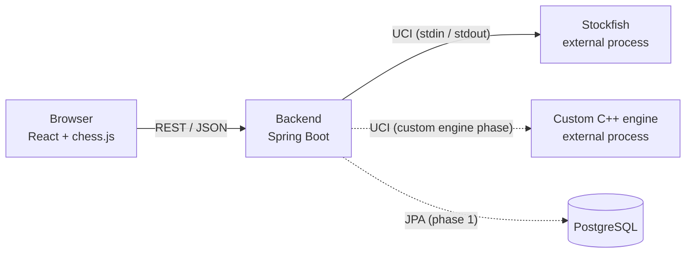

# Architecture

Initial version, for the initial phase. It grows with the database, login and the custom engine in their own phases.

## Overview



Dashed lines are parts that do not exist yet.

## Containers (Docker Compose)

| Service | Contents | Phase |
|---|---|---|
| `frontend` | Vite development server | Initial |
| `backend` | Spring Boot application and the Stockfish binary compiled inside the image | Initial |
| `db` | PostgreSQL with a persistent volume | Phase 1 |

The custom engine, once it exists, will be compiled in a stage of the backend Dockerfile and will live next to Stockfish in the same image.

## Flow of a move against Stockfish

1. The user moves a piece on the board. `chess.js` checks that the move is legal.
2. The frontend sends the position (FEN) to the backend over REST.
3. The backend gives Stockfish the position and asks for a move:
   ```
   position fen <FEN>
   go movetime 1000
   ```
4. Stockfish answers `bestmove e7e5` and the backend returns it to the frontend as JSON.
5. The frontend applies the move on the board.

## Why an external process

Stockfish and the custom engine run as independent processes that speak UCI over standard input and output, not as libraries linked into the backend. This keeps the backend language independent of the engine language, treats both engines the same way and uses the same integration other chess services use. More detail in [decisions.md](decisions.md) (D-04).

## Test endpoint: contract

Decisions D-12 to D-15 in [decisions.md](decisions.md).

**`POST /api/test-stockfish`**

Request (JSON):

| Field | Type | Required | Description |
|---|---|---|---|
| `fen` | string | yes | Full position in FEN notation |
| `movetime` | integer | no | Search time in milliseconds. Default 1000; minimum 100, maximum 5000 |

```json
{ "fen": "rnbqkbnr/pppppppp/8/8/4P3/8/PPPP1PPP/RNBQKBNR b KQkq - 0 1", "movetime": 1000 }
```

Response 200:

```json
{ "bestmove": "e7e5" }
```

- `bestmove` uses UCI notation: origin and destination (`e2e4`) and, for a promotion, the piece (`e7e8q`). `chess.js` expects origin, destination and promotion as separate values, so the frontend must split it.
- If there are no legal moves (checkmate or stalemate), Stockfish answers `(none)` and the endpoint returns `{ "bestmove": null }`. The frontend should detect the end of the game with `chess.js` before calling. Check this case in the tests.

Errors:

| Code | When | Body |
|---|---|---|
| 400 | `fen` missing, containing line breaks or disallowed characters, longer than 100 characters or without 6 fields; `movetime` out of range | `{ "error": "<reason>" }` |
| 503 | The engine fails and the retry also fails (see D-15) | `{ "error": "Engine unavailable" }` |

What the backend does on each request:

1. Validates the request. The input goes to a line-based text protocol, so it cannot contain line breaks. The legality of the position is validated by the frontend with `chess.js`; an illegal position that crashes the engine ends up in the error case of D-15.
2. Takes a Stockfish process from the pool.
3. Sends it `position fen <fen>` and `go movetime <movetime>`.
4. Reads the output up to the `bestmove` line, with a maximum wait.
5. Returns the process to the pool and responds.

When each process starts, the UCI handshake is done (`uci`, wait for `uciok`), the options from D-13 are set and `isready` confirms it (wait for `readyok`).

## Open questions

- What to do when every process in the pool is busy: wait with a time limit or reject the request.

Each answer is recorded in [decisions.md](decisions.md) once it is made.
