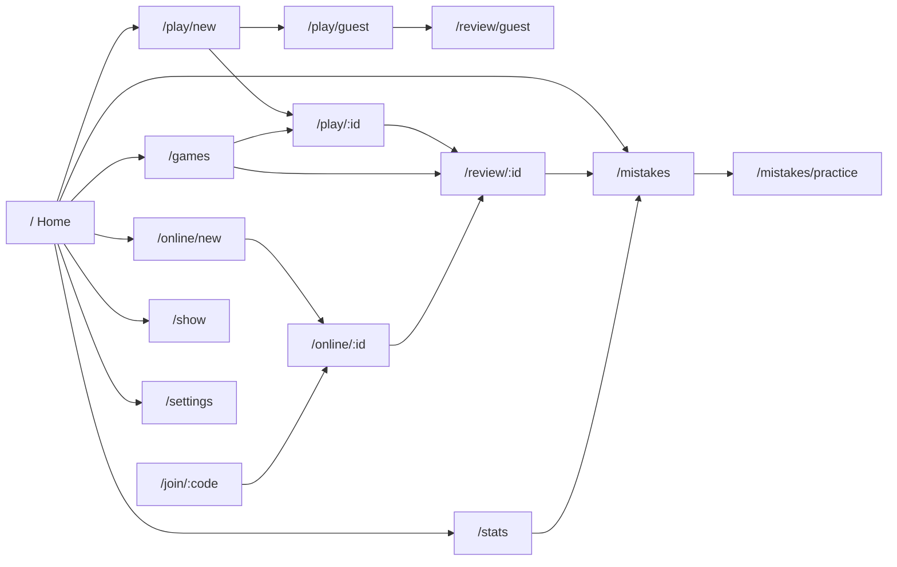
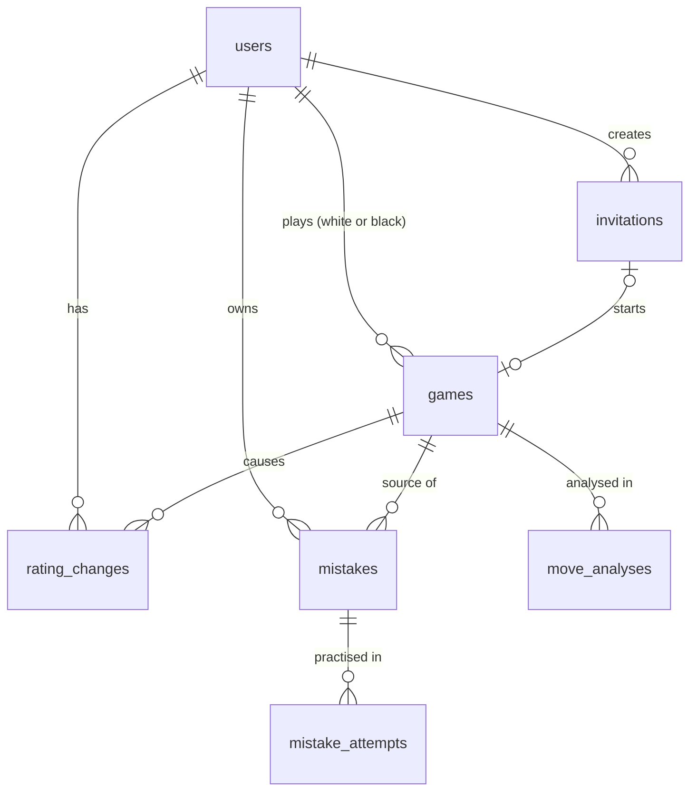
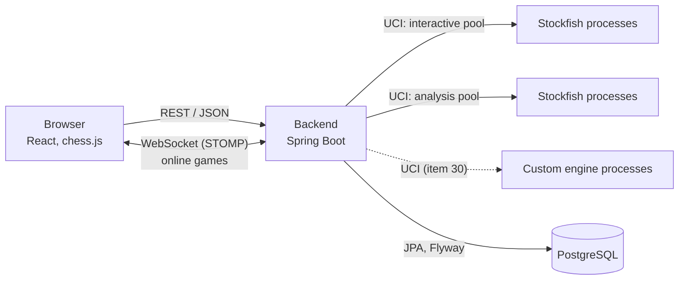

# Requirements

Requirements specification of CheckMate. It is the single source of truth of the project: what the system must do, under which conditions, with which technology, how it is verified and in which order it is built. Its structure follows ISO/IEC/IEEE 29148, reduced to what a one-person project needs.

**Version 1.0 (baseline), 2026-11-10.** Approved by the author. Changes follow [section 18](#18-change-management-and-history).

**Rules of this document.**

- Nothing here is open. Every requirement has a concrete value. Where a value can only be confirmed by trying it (bot strength, timings), the requirement says in which plan item it is validated; if validation fails, the value is changed through [section 18](#18-change-management-and-history).
- Information lives in one place. Other files link to IDs in this document instead of repeating its content. The only other project documents are [decisions.md](decisions.md) (why each decision was taken) and [devlog.md](devlog.md) (what happened in each work session).
- When anything changes (a feature, a priority, the stack, the use of AI, the plan), this document is updated first, and the code follows.

## Contents

1. [Introduction](#1-introduction)
2. [Overall description](#2-overall-description)
3. [Use cases](#3-use-cases)
4. [Feature map and priorities](#4-feature-map-and-priorities)
5. [Functional requirements](#5-functional-requirements)
6. [User interface](#6-user-interface)
7. [API](#7-api)
8. [Engine interface (UCI)](#8-engine-interface-uci)
9. [Data model](#9-data-model)
10. [Non-functional requirements](#10-non-functional-requirements)
11. [Architecture and technology](#11-architecture-and-technology)
12. [Quality assurance](#12-quality-assurance)
13. [AI-assisted development](#13-ai-assisted-development)
14. [Acceptance criteria](#14-acceptance-criteria)
15. [Scope](#15-scope)
16. [Implementation plan](#16-implementation-plan)
17. [Risks](#17-risks)
18. [Change management and history](#18-change-management-and-history)

---

## 1. Introduction

### 1.1 Purpose

This document describes CheckMate, a web application to learn and improve at chess, developed as the Final Degree Project (TFG) of a Software Engineering degree at UCM. It has three readers:

- The author, as the reference while designing, building and testing.
- The supervisor and the thesis committee, to see the scope and check the result against it.
- The AI agents that work in the repository ([section 13](#13-ai-assisted-development)). They implement what this document says and nothing else.

### 1.2 Scope

CheckMate is a web application where the user:

- plays against bots of ten strengths, from absolute beginner to full Stockfish, with or without an account;
- gets live help while playing (trainer mode);
- reviews finished games with an evaluation and a classification of every move (review mode);
- turns their own mistakes into exercises and repeats them until they are mastered (mistake bank);
- plays other people online through an invitation code or link, with a clock;
- follows ratings, statistics and recommendations about what to practise;
- resumes unfinished games against the bot;
- watches two engines play each other (Show mode);
- plays against a chess engine written by the author.

The core idea is helping the user learn. The system has five parts: a web frontend, a backend with a REST and WebSocket API, a PostgreSQL database, chess engines that run as external processes, and the AI agent setup used to build it. What is left out is in [section 15](#15-scope).

### 1.3 Definitions

| Term | Meaning |
|---|---|
| Accuracy | Score from 0 to 100 of how close a move, or all the moves of one side in a game, were to the best moves (FR-ANA-10). |
| Alpha-beta pruning | Optimisation of minimax that skips branches that cannot change the result. |
| Analysis | Evaluation of every position of a game by the engine, with the classification of every move (FR-ANA). |
| Assisted game | A game against a bot in which trainer mode was on at some moment. |
| Bot | An engine playing at a chosen level as an opponent. |
| Bot rating | The user's Elo estimated from games against bots (FR-RAT). |
| Calibration | The first three rated games against bots, used to estimate the initial bot rating (FR-RAT-04). |
| Centipawn (cp) | Unit of evaluation: one hundredth of a pawn. |
| Classification | The category of a move: Brilliant, Great, Best, Good, Book, Inaccuracy, Mistake, Miss or Blunder (FR-ANA-07 to FR-ANA-09). |
| Elo | Rating system that estimates strength from results. |
| Engine | Program that analyses positions and chooses moves: Stockfish or the custom engine. |
| Evaluation | The engine's estimate of a position, in centipawns or as mate in N. Shown from White's point of view. |
| Expected points (E) | Probability-like value from 0 (lost) to 1 (won) computed from an evaluation (FR-ANA-06). |
| FEN | Forsyth-Edwards Notation: one line with 6 fields that describes a position. |
| FEN key | The first four FEN fields (placement, side to move, castling, en passant). Two positions with the same key are the same position. |
| Figurine notation | SAN with piece symbols instead of letters (`♘f3`), independent of the interface language. |
| Guest | A visitor without a session. |
| Increment | Seconds added to a player's clock after each of their moves. |
| Invitation | Code and link that let a registered user join an online game created by another (FR-ONL). |
| JWT | JSON Web Token: a signed token that identifies the user in each request. |
| Level | One of the ten bot strengths L1 to L10 (FR-PLAY-02). |
| Mistake bank | The user's collection of positions where they made a Mistake, Blunder or Miss, practised with spaced repetition (FR-MIS). |
| MoSCoW | Prioritisation in Must, Should, Could and Won't. |
| MultiPV | UCI option that makes the engine report its N best moves. |
| Online rating | The user's Elo from rated online games. |
| Perft | Count of the leaf nodes of the legal move tree up to a depth. Checks a move generator. |
| PGN | Portable Game Notation: standard text format for chess games. |
| Phase | Opening, middlegame or endgame of a position (FR-ANA-11). |
| Ply | One move by one side. |
| Pool | Set of long-lived engine processes reused between requests (FR-ENG). |
| Puzzle rating | The user's rating from Lichess puzzles (Could, FR-PUZ). |
| Quiescence search | Search extension that keeps examining captures at the leaves. |
| Rated / casual | Whether an online game changes the online ratings. |
| SAN | Standard Algebraic Notation: `Nf3`, `exd5`, `O-O`. |
| Show mode | Two engines play each other while the user watches. |
| Spaced repetition | Practice method that shows an item again after growing intervals while it is answered correctly (FR-MIS-06). |
| Spike | Short technical experiment that proves a path end to end. |
| Time control | Minutes per player plus increment, for example 5+2. |
| Transposition table | Cache of positions already searched. |
| UCI | Universal Chess Interface: text protocol, one command per line over standard input and output, between a program and an engine. A UCI move is origin and destination plus the promotion piece: `e2e4`, `e7e8q`. |
| WebSocket | Persistent two-way connection between browser and server, used for online games. |

### 1.4 References

Project documents: [decisions.md](decisions.md) (D-01 onwards), [devlog.md](devlog.md), [AGENTS.md](../AGENTS.md) and [CLAUDE.md](../CLAUDE.md) (rules for AI agents).

External references:

- ISO/IEC/IEEE 29148:2018, *Requirements engineering*.
- Steven J. Edwards, *Portable Game Notation Specification and Implementation Guide* (1994). Defines PGN and FEN.
- UCI protocol description by Stefan Meyer-Kahlen, distributed with UCI engines.
- Stockfish and its UCI options: <https://github.com/official-stockfish/Stockfish>
- chess.js: <https://github.com/jhlywa/chess.js>
- react-chessboard: <https://github.com/Clariity/react-chessboard>
- chesslib: <https://github.com/bhlangonijr/chesslib>
- Lichess open database (puzzles, CC0): <https://database.lichess.org/>
- Lichess opening names (CC0): <https://github.com/lichess-org/chess-openings>
- Lichess accuracy formulas: <https://lichess.org/page/accuracy>
- chess.com move classifications (model for FR-ANA-07 to FR-ANA-09): <https://support.chess.com/en/articles/8572705>
- Chess Programming Wiki (perft and search techniques): <https://www.chessprogramming.org/>

### 1.5 Conventions

**IDs.** `UC-NN` use cases; `FR-<AREA>-NN` functional; `UI-NN` interface; `API-NN` and `WS-NN` API; `UCI-NN` engine interface; `DM-NN` data; `NFR-<AREA>-NN` non-functional; `CON-NN` constraints; `AS-NN` assumptions; `AC-<AREA>-NN` acceptance criteria; `RSK-NN` risks. From version 1.0 an ID is never reused or renumbered: a dropped requirement keeps its row, marked *Removed*.

**Priority** (MoSCoW): Must (without it the project fails its goal), Should (important, the core works without it), Could (if there is time; otherwise future work in the thesis), Won't (not in this version, [section 15](#15-scope)). A requirement can have a lower priority than its feature.

**Item.** "Item N" is item N of the implementation plan ([section 16](#16-implementation-plan)). The `Item` column says where a requirement is built.

**Configuration.** Values written as `property` (default) are configuration properties ([section 11.6](#116-configuration)); the default is the agreed value.

---

## 2. Overall description

### 2.1 Product vision

Most chess applications either play very well or analyse very well, and leave the learner alone with a number. CheckMate puts the engine at the service of learning: it adapts its strength to the user, points out what is happening while the user plays, explains afterwards which moves were good and which were not, and brings the user's own mistakes back as exercises until they stop making them. The name joins *check*, *checkmate* and *mate* in the sense of "companion".

### 2.2 Goals

| ID | Goal | Features |
|---|---|---|
| G-01 | Play at a suitable level, from absolute beginner to strong player. | Play against the bot, bot rating |
| G-02 | Learn while playing. | Trainer mode |
| G-03 | Learn from finished games. | Analysis, review mode |
| G-04 | Stop repeating the same mistakes. | Mistake bank |
| G-05 | Play against other people. | Online play by invitation |
| G-06 | See one's own progress and what to work on. | Ratings, statistics, recommendations |
| G-07 | Compare engines. | Show mode |
| G-08 | Design, build and integrate an own chess engine (academic goal). | Custom engine |
| G-09 | Start the whole system with one command and keep it working. | Infrastructure, CI |

### 2.3 Users and access

| Class | Description |
|---|---|
| Guest | Visitor without a session. Can try the product without registering. |
| Player | Registered user. Knows the rules of chess (AS-05), from beginner to club player. May not know chess notation. |
| Operator | Whoever runs the system: the author, or the committee for the demo. Starts it, configures it through environment variables and reads the logs. |

There is no administrator role. Stakeholders who are not users: the supervisor and the thesis committee.

Access by feature:

| Feature | Guest | Player |
|---|---|---|
| Play against the bot (any level) | Yes, unlimited, nothing stored | Yes, stored |
| Trainer mode | No | Yes |
| Review mode | Only the game just played, one per day (FR-ACC-11) | Unlimited, own games and PGN files |
| Ratings, calibration, statistics, recommendations | No | Yes |
| Mistake bank | No | Yes |
| Online play | No | Yes |
| Games in progress | No | Yes |
| Show mode | No | Yes |
| Language and theme selector | Yes | Yes |

### 2.4 Operating environment

- **Browsers.** Current Chrome, Edge and Firefox on desktop (Must); the same browsers on mobile phones (Should).
- **Development.** Windows 11 with PowerShell and Docker Desktop. JDK 24 installed, project target Java 21. Node `^20.19.0` or `>=22.12.0`. Everything runs with `docker compose up` (NFR-DEP-01).
- **Production.** The frontend is deployed on Vercel with the author's domain managed in Cloudflare. The backend and the database are deployed when the demo needs them; the host is chosen then (D-29). The requirements keep the backend portable to any host that runs a Linux x86-64 container (NFR-DEP).
- **Ports in development.** Frontend 5173, backend 8080, database 5432 inside the Compose network only.

### 2.5 Constraints

| ID | Constraint | Decision |
|---|---|---|
| CON-01 | Final Degree Project with a single developer; defence in June 2027. Safe, simple choices beat clever ones. | |
| CON-02 | One repository with `frontend/`, `backend/` and `engine/`. | D-01 |
| CON-03 | Fixed stack ([section 11.4](#114-technology-and-versions)). It is not changed without the author's agreement. | D-02, D-03, D-07, D-17 |
| CON-04 | Engines run only as external processes over UCI, never linked into the backend. | D-04 |
| CON-05 | Stockfish is compiled from the official source inside the backend Dockerfile; neither its source nor its binaries are stored in the repository. | D-05 |
| CON-06 | The project is GPL v3. Every third-party component must have a compatible licence ([section 11.5](#115-dependencies-and-licences)). | D-10 |
| CON-07 | Everything in the repository is in English: file names, code, comments, documentation and commit messages. The user interface is in Spanish and English (FR-PREF). | D-16 |
| CON-08 | The custom engine is written only by the author. AI agents review it, explain concepts and help debug, but never write or edit its code ([section 13](#13-ai-assisted-development)). | D-19 |
| CON-09 | Features are built one at a time, end to end (entity, endpoint, screen, tests). | D-09 |
| CON-10 | Work happens directly on `main`, with a git tag when each phase closes. | D-10 |
| CON-11 | New dependencies are added only when listed in [section 11.5](#115-dependencies-and-licences); adding another one is a change to this document. | |

### 2.6 Assumptions and dependencies

| ID | Assumption | Checked in |
|---|---|---|
| AS-01 | The Stockfish source and its default network can be downloaded while the backend image is built. | Item 5 |
| AS-02 | The server has an x86-64 CPU. Whether it has AVX2 is detected at start-up (FR-ENG-16). | Item 5 |
| AS-03 | Stockfish's `Skill Level`, `UCI_LimitStrength` and `UCI_Elo`, plus random choice for the two lowest levels, give ten levels that are ordered by strength. | Item 14 (AC-PLAY-06) |
| AS-04 | The Lichess opening names dataset (CC0) is enough to recognise book moves. | Item 16 |
| AS-05 | Users already know how the pieces move. CheckMate teaches how to play better, not the rules. | |
| AS-06 | Few users at the same time: the author, testers and the committee during the demo. | |

---

## 3. Use cases

| ID | Actor | Use case | Main flow | Requirements |
|---|---|---|---|---|
| UC-01 | Guest | Play against a bot | Opens the app, chooses level and colour, plays until the game ends, sees the result. Nothing is stored. | FR-PLAY, FR-ACC-10 |
| UC-02 | Guest | Review the game just played | At the end of a guest game, presses "Review". If the daily review is still available, sees the analysis; otherwise is invited to register. | FR-ACC-11, FR-REV |
| UC-03 | Guest | Register and log in | Registers with username and password, is logged in, and lands on the home screen. | FR-ACC-01 to FR-ACC-06 |
| UC-04 | Player | Calibrate the bot rating | Starts "Find my level", plays three games against levels chosen by the system, gets an initial bot rating and a recommended level. | FR-RAT-03 to FR-RAT-06 |
| UC-05 | Player | Play with the trainer | Starts a game against a bot with trainer mode on, turns on the help they want, plays, and sees the game stored as assisted. | FR-PLAY, FR-TRN |
| UC-06 | Player | Review a game | Opens a finished game, or uploads a PGN. Moves through the game with the evaluation bar, the graph, the classification of each move and the best alternatives. | FR-ANA, FR-REV |
| UC-07 | Player | Practise their mistakes | Opens "My mistakes", solves the positions that are due, sees the solution when failing, and watches positions move towards "mastered". | FR-MIS |
| UC-08 | Player | Invite someone to an online game | Chooses time control, colour and rated or casual, shares the code or link, and the game starts when the other player joins. | FR-ONL-01 to FR-ONL-04 |
| UC-09 | Player | Join and play an online game | Opens the link or types the code, plays with the clock running, can offer a draw or resign, and sees the result and the rating change. | FR-ONL |
| UC-10 | Player | Follow progress | Opens statistics, filters by period and opponent, and follows the recommendations on the home screen. | FR-STAT |
| UC-11 | Player | Resume a game | Opens "Games in progress" and continues a game against a bot where it was left. | FR-SAVE |
| UC-12 | Player | Watch two engines | Chooses two bots, starts the game, pauses or changes the speed. | FR-SHOW |
| UC-13 | Anyone | Change language or theme | Switches between Spanish and English, or light, dark and system theme, from the header. | FR-PREF |
| UC-14 | Player | Play the custom engine | Chooses the CheckMate engine as opponent. | FR-CEN-08 |

Could use cases (if built): matchmaking by rating (FR-MM), Lichess puzzles by rating (FR-PUZ), endgame practice (FR-END), opening practice (FR-OPN).

---

## 4. Feature map and priorities

| Feature | MoSCoW | Items | Requirements |
|---|---|---|---|
| Initial phase (browser, backend and Stockfish end to end) | Must | 1 to 8 | [5.1](#51-initial-phase) |
| AI workspace and CI | Must | 9, 10 | [12](#12-quality-assurance), [13](#13-ai-assisted-development) |
| Design system and internationalisation | Must | 11, 12 | [6](#6-user-interface), [5.4](#54-language-and-theme) |
| Accounts, guests and database | Must | 13 | [5.3](#53-accounts-and-access), [9](#9-data-model) |
| Engine service | Must | 5, 6, 14, 16 | [5.2](#52-engine-service) |
| Play against the bot | Must | 14 | [5.5](#55-play-against-the-bot) |
| Ratings and calibration | Must | 15 | [5.6](#56-ratings) |
| Analysis and move classification | Must | 16 | [5.7](#57-analysis-and-move-classification) |
| Review mode | Must | 17 | [5.8](#58-review-mode) |
| Trainer mode | Must | 18 | [5.9](#59-trainer-mode) |
| Mistake bank | Must | 19 | [5.10](#510-mistake-bank) |
| Online play by invitation | Must | 20 | [5.11](#511-online-play-by-invitation) |
| Statistics and recommendations | Should | 22 | [5.12](#512-statistics-and-recommendations) |
| Games in progress | Should | 23 | [5.13](#513-games-in-progress) |
| Show mode | Should | 24 | [5.14](#514-show-mode) |
| Custom engine, minimum version | Should | 25 to 30 | [5.15](#515-custom-engine) |
| Custom engine improvements and match tooling | Could | 31 to 35 | [5.15](#515-custom-engine) |
| Matchmaking by rating | Could | 36 | [5.16](#516-could-features) |
| Lichess puzzles by rating | Could | 37 | [5.16](#516-could-features) |
| Endgames | Could | 38 | [5.16](#516-could-features) |
| Openings practice | Could | 39 | [5.16](#516-could-features) |

MoSCoW says what is cut first if time runs short; the build order is in [section 16](#16-implementation-plan). Infrastructure and CI come first, and every feature brings its own tests from the start (DoD, [section 12.3](#123-definition-of-done)).

---

## 5. Functional requirements

### 5.1 Initial phase

Technical spike: the browser, the backend and Stockfish talk to each other. No accounts, no database. The test endpoint is removed in item 14 (FR-PLAY-17).

| ID | Requirement | Priority | Item |
|---|---|---|---|
| FR-INIT-01 | The backend answers `GET /api/health` with 200 and `{"status":"UP"}`. | Must | 4 |
| FR-INIT-02 | The backend offers the test endpoint `POST /api/test-stockfish` ([section 7.5](#75-test-endpoint)): it receives a FEN and an optional search time and returns Stockfish's best move. | Must | 6 |
| FR-INIT-03 | The frontend shows a board on which the user plays against Stockfish from the starting position. | Must | 7 |
| FR-INIT-04 | The board accepts only legal moves, checked with `chess.js`. | Must | 7 |
| FR-INIT-05 | After each user move, the frontend sends the new FEN to the test endpoint and plays the returned move, split into origin, destination and promotion piece for `chess.js`. | Must | 7 |
| FR-INIT-06 | After every move the frontend checks with `chess.js` whether the game has ended (checkmate, stalemate, insufficient material, threefold repetition, fifty-move rule). If so, it shows the result and the reason and requests no more moves. | Must | 7 |
| FR-INIT-07 | If a request fails (400, 503 or no connection), the frontend shows an error, keeps the position and lets the user try again. | Must | 7 |
| FR-INIT-08 | `docker compose up` starts the frontend and the backend with Stockfish, and a full game against Stockfish can be played from the browser. | Must | 8 |

### 5.2 Engine service

How the backend runs and talks to engines. It applies to every feature that uses an engine.

| ID | Requirement | Priority | Item |
|---|---|---|---|
| FR-ENG-01 | The backend keeps pools of long-lived engine processes that are not closed between requests. Each use takes a process from a pool and returns it when done. | Must | 6 |
| FR-ENG-02 | There are two pools per engine: the interactive pool (bot moves, trainer) and the analysis pool (FR-ANA). Sizes: `engine.pool.interactive-size` (1) and `engine.pool.analysis-size` (1). Analysis never takes processes from the interactive pool, so playing is never slowed down by analysis. The analysis pool is created in item 16. | Must | 6, 16 |
| FR-ENG-03 | More capacity is obtained by more processes, never by more threads per process. | Must | 6 |
| FR-ENG-04 | When a process starts, the backend sends `uci` and waits for `uciok`, sets `Threads=1` and `Hash=64`, sends `isready` and waits for `readyok`. Only then does the process join its pool. | Must | 6 |
| FR-ENG-05 | Before each use, the backend sets every option that use needs (level options, `MultiPV`), because a process keeps the options of its previous use. | Must | 6 |
| FR-ENG-06 | Requests carry no engine state. Each search receives the full position (FEN); the backend keeps no game state inside engine processes. | Must | 6 |
| FR-ENG-07 | A search sends `position fen <fen>` and `go movetime <ms>` and reads the output up to the `bestmove` line. | Must | 6 |
| FR-ENG-08 | The backend waits for `bestmove` at most `movetime` plus `engine.timeout-margin-ms` (2000). | Must | 6 |
| FR-ENG-09 | If a process closes or does not answer in time, the backend discards it, starts a new one and repeats the request up to `engine.retries` (1) times. If it still fails, the API answers 503 `ENGINE_UNAVAILABLE` and the failure is logged. | Must | 6 |
| FR-ENG-10 | The backend always drains the standard error of every process (for example with `redirectErrorStream(true)`). | Must | 6 |
| FR-ENG-11 | When the application stops, every engine process is shut down with `quit`, and killed if it does not exit within 2 s. | Must | 6 |
| FR-ENG-12 | A move request takes a process for one search. An analysis keeps the same process for the whole game. | Must | 6, 16 |
| FR-ENG-13 | The backend reads only the move after `bestmove` and ignores `ponder <move>`. `bestmove (none)` means there are no legal moves. | Must | 6 |
| FR-ENG-14 | When every process of a pool is busy, the request waits up to `engine.pool.acquire-timeout-ms` (5000) for a free one; after that it answers 503 `ENGINE_UNAVAILABLE`. | Must | 6 |
| FR-ENG-15 | Evaluations are taken from the last `info` line of each `multipv` index before `bestmove` (`score cp <x>` or `score mate <n>`), together with its `pv`, and converted to White's point of view, because UCI gives them from the side to move. | Must | 16 |
| FR-ENG-16 | The backend image contains two Stockfish builds, `x86-64-avx2` and `x86-64`. At start-up the backend checks whether the CPU supports AVX2 (the `avx2` flag in `/proc/cpuinfo`), uses the matching build and logs which one. | Must | 5 |
| FR-ENG-17 | Stockfish and the custom engine use the same mechanism. Each engine type (`STOCKFISH`, `CUSTOM`) has its own pools, configured by its executable path, so adding the custom engine changes no feature code. | Should | 30 |

### 5.3 Accounts and access

| ID | Requirement | Priority | Item |
|---|---|---|---|
| FR-ACC-01 | A guest registers with a username and a password. The username has 3 to 20 characters (letters, digits and `_`) and is unique ignoring case; if it is taken, the API answers 409 `USERNAME_TAKEN`. The password has 8 to 72 characters. After registering, the user is logged in. | Must | 13 |
| FR-ACC-02 | A user logs in with username and password and receives a JWT. A wrong username and a wrong password give the same answer, 401 `INVALID_CREDENTIALS`. | Must | 13 |
| FR-ACC-03 | The JWT is signed with HS256 and expires after `security.jwt.ttl` (24 h). A request with an expired or invalid token answers 401 `UNAUTHENTICATED`, and the frontend then logs the user out and shows the login screen. | Must | 13 |
| FR-ACC-04 | The frontend keeps the token in `localStorage`, so the session survives a reload until the token expires. | Must | 13 |
| FR-ACC-05 | The user can log out; the frontend discards the token. | Must | 13 |
| FR-ACC-06 | Every endpoint requires a valid token, except the public ones listed in API-04. | Must | 13 |
| FR-ACC-07 | A user can only read and change their own data. A request for another user's data answers 404 `NOT_FOUND`, as if it did not exist. Online games belong to both players. | Must | 13 |
| FR-ACC-08 | A user can change their password by giving the current one. | Could | 13 |
| FR-ACC-09 | A user can delete their account after confirming with their password. All their data is deleted. In online games, the other player keeps their copy and the deleted user appears as "Deleted user". | Should | 13 |
| FR-ACC-10 | A guest can play any number of games against bots at any level, through the stateless bot endpoint (FR-PLAY-13). Guests have no trainer, and nothing of their games is stored. | Must | 14 |
| FR-ACC-11 | At the end of a guest game, the guest can review that game. Each IP gets `guest.reviews-per-day` (1) review per calendar day (Europe/Madrid time); beyond that the API answers 429 `GUEST_REVIEW_LIMIT` and the frontend invites the guest to register. Guests cannot upload or paste a PGN. The server does not check that the game was played on CheckMate; the daily limit is what protects engine time. | Must | 17 |
| FR-ACC-12 | IP addresses are never stored in clear: only as a salted SHA-256 hash (`security.ip-hash-salt`). | Must | 13 |
| FR-ACC-13 | Public engine endpoints and login are limited per IP: `POST /api/bot/move` to `ratelimit.bot-move-per-minute` (60) and `POST /api/auth/login` to `ratelimit.login-per-minute` (10). Beyond that the API answers 429 `RATE_LIMITED`. | Should | 13, 14 |

### 5.4 Language and theme

| ID | Requirement | Priority | Item |
|---|---|---|---|
| FR-PREF-01 | The interface is available in Spanish and English. A selector in the header switches the language at once, without reloading. | Must | 12 |
| FR-PREF-02 | On the first visit, the language comes from the browser: Spanish if the browser language starts with `es`, English otherwise. | Must | 12 |
| FR-PREF-03 | The theme can be light, dark or system (follows the operating system). A selector in the header switches it at once. | Must | 12 |
| FR-PREF-04 | Language and theme are kept in `localStorage`. For players they are also stored in the profile and applied after login; the profile wins. | Must | 12, 13 |
| FR-PREF-05 | Every interface text comes from the translation files (`es.json`, `en.json`). There are no hard-coded texts in components, and an automated test checks that every key exists in both files. | Must | 12 |
| FR-PREF-06 | The API returns error codes ([section 7.2](#72-errors)). The frontend translates the code; the English `error` message is for logs and debugging. | Must | 12, 13 |
| FR-PREF-07 | Dates and numbers are formatted with the selected language's locale. | Must | 12 |
| FR-PREF-08 | Move lists use figurine notation (`♘f3`), so they do not depend on the language. PGN files use standard SAN with English letters, as the PGN standard requires. | Must | 14 |

### 5.5 Play against the bot

| ID | Requirement | Priority | Item |
|---|---|---|---|
| FR-PLAY-01 | The user starts a game against a bot by choosing the level and their colour (White, Black or random). A player also chooses whether trainer mode starts on, and sees the recommended level (FR-RAT-09). | Must | 14 |
| FR-PLAY-02 | There are ten levels. L1 to L9 are rated; L10 is not. | Must | 14 |
| FR-PLAY-03 | The parameters of each level are configuration properties with the defaults below. Item 14 validates them with AC-PLAY-06; if a level is not ordered by strength, its parameters are changed through [section 18](#18-change-management-and-history). | Must | 14 |
| FR-PLAY-04 | Random-choice levels (L1, L2): with probability `p` the backend plays a legal move chosen uniformly at random (legal moves from `chesslib`); otherwise it plays Stockfish's best move at the level's search time. | Must | 14 |
| FR-PLAY-05 | The board shows the user's side at the bottom. The user moves by dragging or by clicking origin and destination. Only legal moves are accepted (`chess.js`). | Must | 14 |
| FR-PLAY-06 | When a user's pawn reaches the last rank, the user chooses the promotion piece. | Must | 14 |
| FR-PLAY-07 | While the bot thinks, the interface says so and accepts no moves. The bot's move is shown no sooner than `bot.min-reply-ms` (400) after the user's move, so instant replies of low levels do not feel abrupt. | Must | 14 |
| FR-PLAY-08 | The screen shows the move list in figurine notation. | Must | 14 |
| FR-PLAY-09 | The board highlights the last move and a king in check. | Must | 14 |
| FR-PLAY-10 | The user can resign. | Must | 14 |
| FR-PLAY-11 | A game ends by checkmate, stalemate, insufficient material, threefold repetition, the fifty-move rule or resignation. The screen shows the result and the reason, and offers to review the game. | Must | 14 |
| FR-PLAY-12 | Player games are kept on the server. The game is created through the API; every user move is sent to the server, validated with `chesslib`, stored, and answered in the same response with the bot's move. A game is therefore saved after every move. | Must | 14 |
| FR-PLAY-13 | Guest games are stateless: the frontend keeps the game and asks `POST /api/bot/move` for each bot move. | Must | 14 |
| FR-PLAY-14 | A finished player game is stored with: players, bot engine and level, the user's colour, result, reason, trainer flag, calibration flag, moves, dates of start and end. The player sees their finished games, newest first, and opens any of them in review mode. | Must | 14 |
| FR-PLAY-15 | The user can flip the board. | Could | 14 |
| FR-PLAY-16 | The user can download a finished game as a PGN file. | Could | 17 |
| FR-PLAY-17 | When item 14 is done, the test endpoint `POST /api/test-stockfish` is removed; the bot endpoints replace it and keep its FEN validation (TEST-02, TEST-03). | Must | 14 |

Levels (defaults of FR-PLAY-03):

| Level | Label | Rated | Mechanism | Parameters |
|---|---|---|---|---|
| L1 | 100 | Yes | Random choice | `p` 0.9, best move at 50 ms |
| L2 | 500 | Yes | Random choice | `p` 0.5, best move at 50 ms |
| L3 | 800 | Yes | `Skill Level` | Skill Level 0, 100 ms |
| L4 | 1000 | Yes | `Skill Level` | Skill Level 3, 150 ms |
| L5 | 1200 | Yes | `Skill Level` | Skill Level 6, 200 ms |
| L6 | 1400 | Yes | `UCI_LimitStrength` + `UCI_Elo` | UCI_Elo 1400, 500 ms |
| L7 | 1700 | Yes | `UCI_LimitStrength` + `UCI_Elo` | UCI_Elo 1700, 500 ms |
| L8 | 2000 | Yes | `UCI_LimitStrength` + `UCI_Elo` | UCI_Elo 2000, 800 ms |
| L9 | 2400 | Yes | `UCI_LimitStrength` + `UCI_Elo` | UCI_Elo 2400, 1000 ms |
| L10 | Max | No | Full strength | 1000 ms |

Labels are approximate. Stockfish calibrates `UCI_Elo` (range 1320 to 3190) at 120 s + 1 s against CCRL 40/4, which is not the scale of chess.com or Lichess; labels below 1320 are CheckMate's own estimate.

### 5.6 Ratings

| ID | Requirement | Priority | Item |
|---|---|---|---|
| FR-RAT-01 | Each player has up to three separate ratings: bot rating, online rating and puzzle rating (the last only if FR-PUZ is built). They are never mixed. | Must | 15 |
| FR-RAT-02 | Ratings use Elo. Expected score `E = 1 / (1 + 10^((Ro - R) / 400))`; new rating `R' = round(R + K * (S - E))` with `K` = `rating.k` (32) and `S` = 1, 0.5 or 0. | Must | 15 |
| FR-RAT-03 | A new player's bot rating is *unrated*. While unrated, any level can be played, but no game changes the rating, and no level is recommended. | Must | 15 |
| FR-RAT-04 | Calibration ("Find my level") is three games against bots chosen by binary search, without trainer, with the player as White, Black and White. The search interval starts at [0, 3000]. Each game is played against the rated level whose label is closest to the middle of the interval (on a tie, the lower one). A win sets the lower bound to that label; a loss sets the upper bound to it; a draw ends the calibration with that label as the estimate. After three games, the estimate is the middle of the final interval, rounded to the nearest 10. Resigning counts as a loss. A calibration game left unfinished is resumed like any game in progress. | Must | 15 |
| FR-RAT-05 | The initial bot rating is the estimate if it is at most `rating.calibration.threshold` (1500). Above it, it is `max(threshold, round(estimate * (1 - rating.calibration.reduction)))` with reduction 0.15. Examples: 250 gives 250; 1450 gives 1450; 1700 gives 1500; 2700 gives 2295. | Must | 15 |
| FR-RAT-06 | Calibration happens once per account. | Must | 15 |
| FR-RAT-07 | After calibration, every finished game against L1 to L9 without trainer updates the bot rating, using the level label as the opponent's rating. Games against L10, against the custom engine, and assisted games do not change it. | Must | 15 |
| FR-RAT-08 | The online rating is created at the player's first rated online game: equal to the bot rating if the player is calibrated, otherwise `rating.initial` (1000). Only rated online games change it, for both players. | Must | 20 |
| FR-RAT-09 | The recommended level is the rated level whose label is closest to the bot rating (on a tie, the lower one). It is shown when starting a game and on the home screen. | Must | 15 |
| FR-RAT-10 | Every rating change is stored with its type, value before and after, date and the game that caused it. | Must | 15 |

Calibration examples:

| Game 1 | Game 2 | Game 3 | Final interval | Estimate | Initial rating |
|---|---|---|---|---|---|
| L6 (1400): win | L8 (2000): win | L9 (2400): win | [2400, 3000] | 2700 | 2295 |
| L6 (1400): win | L8 (2000): loss | L7 (1700): win | [1700, 2000] | 1850 | 1573 |
| L6 (1400): loss | L3 (800): win | L4 (1000): loss | [800, 1000] | 900 | 900 |
| L6 (1400): loss | L3 (800): loss | L2 (500): loss | [0, 500] | 250 | 250 |
| L6 (1400): draw | | | | 1400 | 1400 |

### 5.7 Analysis and move classification

Analysis runs on the server, with `chesslib` for the chess rules and the analysis pool for the engine.

| ID | Requirement | Priority | Item |
|---|---|---|---|
| FR-ANA-01 | When a player game ends (against a bot, including calibration, or online), it is queued for analysis in the background. | Must | 16 |
| FR-ANA-02 | Background analyses run one at a time per analysis process. A failed analysis is retried once; after that its status is `FAILED`. Each game has an analysis status: `NONE`, `PENDING`, `RUNNING`, `DONE` or `FAILED`. | Must | 16 |
| FR-ANA-03 | Opening an unanalysed game in review analyses it at once, ahead of the queued jobs, and the request answers when the analysis ends. | Must | 16, 17 |
| FR-ANA-04 | Every position of the game (one more than the number of plies) is searched with `MultiPV 2` for `analysis.movetime-ms` (500). For each position the backend keeps the best and the second-best move with their evaluations, and the main line of the best move (up to 8 plies). | Must | 16 |
| FR-ANA-05 | Evaluations are stored and shown from White's point of view; classification works from the point of view of the player who moved. | Must | 16 |
| FR-ANA-06 | Expected points from an evaluation, for the side to judge: `E = 1 / (1 + exp(-0.00368208 * cp))` (the Lichess win percentage divided by 100). A forced mate for that side gives E = 1; a forced mate against it gives E = 0. | Must | 16 |
| FR-ANA-07 | The loss of a move is `L = E_before - E_after` for the player who moved, never below 0. `E_before` is the expected points of the position before the move (that is, of its best move); `E_after`, of the position after the move. The base category comes from L: **Best** (★) L ≤ 0.02; **Good** (✓) L ≤ 0.05; **Inaccuracy** (?!) L ≤ 0.10; **Mistake** (?) L ≤ 0.20; **Blunder** (??) L > 0.20. | Must | 16 |
| FR-ANA-08 | Special categories, checked in this order; the first that matches replaces the base category. **Book** (📖): the position after the move, and every earlier position of the game, are in the opening catalogue. **Brilliant** (!!): L ≤ 0.02; in the main line after the move, the mover's material two plies later is at least 2 points lower than before the move (pawn 1, knight and bishop 3, rook 5, queen 9); `E_before` ≤ 0.90; `E_after` ≥ 0.50. **Great** (!): L ≤ 0.02; the second-best move of the position before is at least 0.10 worse than the best; the move is not the only legal move; it is not a capture on the square where the opponent's previous move captured; 0.05 ≤ `E_before` ≤ 0.95. **Miss** (✗): the base category is Inaccuracy, Mistake or Blunder, and either the opponent's previous move lost at least 0.10 and the mover's E after this move is at least their E before the opponent's previous move minus 0.02, or the mover had a forced mate before the move and E after it is at least 0.80. | Must | 16 |
| FR-ANA-09 | Every threshold of FR-ANA-07 and FR-ANA-08 is a configuration property. Item 16 tunes them on 20 sample games checked by the author, and records the final values in this document. The categories are shown in three groups: exceptional (Brilliant, Great), correct (Best, Good, Book) and errors (Inaccuracy, Mistake, Miss, Blunder). | Must | 16 |
| FR-ANA-10 | Move accuracy: `clamp(103.1668 * exp(-0.04354 * (W_before - W_after)) - 3.1669, 0, 100)`, with W the win percentage (0 to 100) of the player who moved. Game accuracy for each side: the average of the arithmetic mean and the harmonic mean of that side's move accuracies (Lichess method without volatility weights). | Must | 16 |
| FR-ANA-11 | Phase of a position: endgame if the non-pawn material of both sides together is at most `analysis.endgame-material` (26); otherwise opening if the ply number is at most `analysis.opening-plies` (20); otherwise middlegame. | Must | 16 |
| FR-ANA-12 | The opening of a game is the deepest position of the opening catalogue it reached. Its ECO code and name are stored with the game. | Must | 16 |
| FR-ANA-13 | The opening catalogue is imported from the Lichess `chess-openings` dataset when the backend starts. The import is keyed by FEN key, so running it again creates no duplicates. | Must | 16 |
| FR-ANA-14 | Analyses of PGN files and of guest games run on demand and are not stored; they never feed history, statistics or the mistake bank. | Must | 17 |
| FR-ANA-15 | Games with more than `pgn.max-plies` (500) plies are not analysed; the API answers 400 `GAME_TOO_LONG`. | Must | 16 |

### 5.8 Review mode

| ID | Requirement | Priority | Item |
|---|---|---|---|
| FR-REV-01 | A player opens any of their finished games in review mode. | Must | 17 |
| FR-REV-02 | A player reviews a game from a PGN file, uploaded or pasted. The text has at most `pgn.max-bytes` (100 KB). If it holds several games, only the first is reviewed and the user is told. An invalid PGN, or one without moves, is rejected with a message that says why (`INVALID_PGN`). | Must | 17 |
| FR-REV-03 | A guest reviews the game they have just played (FR-ACC-11). | Must | 17 |
| FR-REV-04 | The review screen shows: the board with the best move as an arrow; an evaluation bar; the move list with the icon of each classification; an evaluation graph along the game; and, for the selected move, its category with a short explanation, the evaluation, the best move and the engine's line. | Must | 17 |
| FR-REV-05 | The user moves through the game with buttons (first, previous, next, last), by clicking a move or a point of the graph, and with the left and right arrow keys. | Must | 17 |
| FR-REV-06 | A summary shows, for each side, the accuracy and the number of moves in each category, and the opening name. | Must | 17 |
| FR-REV-07 | While an analysis runs, the screen shows that it is in progress and its estimated duration (positions × `analysis.movetime-ms`). | Must | 17 |
| FR-REV-08 | Evaluations are written from White's point of view: pawns with a sign (`+1.3`, `-0.4`) or mate (`#3` when White mates, `#-3` when Black mates). | Must | 17 |
| FR-REV-09 | Each category has an explanation text in both languages, for example "Mistake: this move gives your opponent a clear advantage. The best move was ♘f3." | Must | 17 |
| FR-REV-10 | From any position of the review, the user can try other moves on the board without changing the game, and see the engine's reply. | Could | 17 |

### 5.9 Trainer mode

Only for players, only in games against bots, never in calibration or online games.

| ID | Requirement | Priority | Item |
|---|---|---|---|
| FR-TRN-01 | The player turns trainer mode on when starting the game, and can turn it on and off during the game. Turning it on marks the game as assisted on the server. | Must | 18 |
| FR-TRN-02 | **Best move.** On request, the board shows the best move for the user as an arrow. Computed by Stockfish at full strength for `trainer.movetime-ms` (1000). | Must | 18 |
| FR-TRN-03 | **Threatened pieces.** The board marks the user's pieces that are attacked and not defended, or attacked by a piece of lower value. Computed in the browser with `chess.js`. | Must | 18 |
| FR-TRN-04 | **Opponent's threat.** On request, the board shows as an arrow the move the opponent would play if it were its turn (search on the same position with the side to move switched). Not offered while the user is in check. | Must | 18 |
| FR-TRN-05 | **Attacks.** The board can mark the squares each side attacks. Computed in the browser. | Must | 18 |
| FR-TRN-06 | **Checks.** The board can mark the user's moves that give check. Computed in the browser. | Must | 18 |
| FR-TRN-07 | **Captures.** The board can mark the user's moves that capture. Computed in the browser. | Must | 18 |
| FR-TRN-08 | Each help is turned on and off separately. The settings are stored with the game. | Must | 18 |
| FR-TRN-09 | An evaluation bar shows the evaluation of the current position. | Should | 18 |
| FR-TRN-10 | Each mark has a short explanation, for example "Your knight on f3 is attacked by the pawn on e4 and is not defended". | Could | 18 |

### 5.10 Mistake bank

| ID | Requirement | Priority | Item |
|---|---|---|---|
| FR-MIS-01 | When a player game is analysed (FR-ANA-01), each of the player's own moves classified as Mistake, Blunder or Miss becomes a mistake bank entry, if FR-MIS-02 holds. Games against bots (assisted, unassisted and calibration) and online games count. | Must | 19 |
| FR-MIS-02 | Only positions with one clear solution become entries: in the position before the move, the best move is at least `mistakes.min-gap` (0.10) better than the second-best. | Must | 19 |
| FR-MIS-03 | An entry stores: the position before the move, the move played, the best move, the engine's line, the category, the phase, the game, the ply and the date. | Must | 19 |
| FR-MIS-04 | Entries are unique per user and FEN key. If the user makes a mistake again in a position already in the bank, its occurrence count goes up and it goes back to box 1, due at once. | Must | 19 |
| FR-MIS-05 | Practice shows the entries that are due, up to `mistakes.session-size` (10) per session, the weakest phase first (FR-STAT-09) and then the oldest due date. The user can filter by phase. | Must | 19 |
| FR-MIS-06 | Spaced repetition with four boxes and intervals of 1, 3, 7 and 21 days (`mistakes.intervals`). A new entry is in box 1 and due at once. A correct answer moves it to the next box, due after that box's interval; a correct answer in box 4 marks it as mastered. A wrong answer sends it back to box 1, due after 1 day. | Must | 19 |
| FR-MIS-07 | The user answers by playing a move, with their colour at the bottom. The answer is correct only if it is the stored best move. After answering, the board shows the best move and the engine's line. | Must | 19 |
| FR-MIS-08 | "My mistakes" lists the entries with filters by status (due, learning, mastered) and phase, and links each one to its game at that move in review mode. | Must | 19 |
| FR-MIS-09 | Every attempt is stored (entry, date, move, correct or not). | Must | 19 |
| FR-MIS-10 | The user can delete an entry. | Should | 19 |

### 5.11 Online play by invitation

Only for players. The server is the referee.

| ID | Requirement | Priority | Item |
|---|---|---|---|
| FR-ONL-01 | A player creates an invitation by choosing: minutes per player (whole number from 1 to 10), increment (whole seconds from 0 to 3), their colour (White, Black or random) and rated or casual. | Must | 20 |
| FR-ONL-02 | The invitation has a 6-character code from `ABCDEFGHJKLMNPQRSTUVWXYZ23456789` and a link `/join/<code>`. It expires after `online.invitation-ttl-hours` (24) and can be cancelled by its creator. A player has at most one open invitation. | Must | 20 |
| FR-ONL-03 | Another player joins by opening the link or typing the code. A missing, expired, cancelled or accepted invitation answers 404 `INVITATION_NOT_AVAILABLE`; the creator cannot join their own. When someone joins, the game is created and both players go to it. | Must | 20 |
| FR-ONL-04 | A player has at most one active online game. Creating or joining while in one answers 409 `ONLINE_GAME_ACTIVE`. | Must | 20 |
| FR-ONL-05 | Moves, clocks and game events travel over a WebSocket ([section 7.4](#74-websocket-protocol)). Only the two players can subscribe to a game. | Must | 20 |
| FR-ONL-06 | The server validates every move with `chesslib` against its own state. An illegal move, or a move out of turn, is rejected with an error to its sender and changes nothing. | Must | 20 |
| FR-ONL-07 | No clock runs until both players have made their first move. Each player has `online.first-move-seconds` (30) for it; otherwise the game is aborted, without rating changes. After that, the clock of the side to move runs on the server, and the increment is added after each move. Every message carries both clocks in milliseconds; clients count down locally and resynchronise with each message. | Must | 20 |
| FR-ONL-08 | When a clock reaches zero, that player loses, unless the opponent has only a king, a king and a bishop, or a king and a knight; then it is a draw. | Must | 20 |
| FR-ONL-09 | The server detects the end of the game: checkmate, stalemate, insufficient material, threefold repetition, fifty-move rule, resignation, time out, draw agreement, abandonment or abort. | Must | 20 |
| FR-ONL-10 | A player can resign, and can offer a draw. The offer stands until the opponent accepts, declines or moves. | Must | 20 |
| FR-ONL-11 | If a player disconnects, the opponent is told. Reconnecting restores the game from the server. The disconnected player's clock keeps running, and after `online.abandon-seconds` (60) without connection the opponent can claim the win (abandonment). | Must | 20 |
| FR-ONL-12 | When a rated game ends, both online ratings change (FR-RAT-08) and the change is shown. Casual games change nothing. | Must | 20 |
| FR-ONL-13 | Finished online games are stored for both players and analysed in the background (FR-ANA-01), so they feed review, the mistake bank and statistics. | Must | 20 |
| FR-ONL-14 | During an online game there is no trainer, no evaluation and no analysis. Review is available when the game ends. | Must | 20 |
| FR-ONL-15 | The game screen shows both usernames, their ratings in rated games, both clocks, the move list, the connection state of the opponent, and the draw and resign buttons. | Must | 20 |
| FR-ONL-16 | If the backend restarts, the online games in progress are aborted without rating changes, and the players are told when they reconnect. | Must | 20 |
| FR-ONL-17 | After a game, either player can offer a rematch with the same settings and the colours swapped; it starts when the other accepts. | Could | 20 |

### 5.12 Statistics and recommendations

Only for players. Computed from stored data; Show games, PGN reviews and guest games are never included.

| ID | Requirement | Priority | Item |
|---|---|---|---|
| FR-STAT-01 | Every statistic can be filtered by period (last 30 days, last 90 days, all) and by opponent (all, bots, online). | Should | 22 |
| FR-STAT-02 | Summary: games played, win percentage, average accuracy of the last 10 analysed games, bot rating (or "unrated"), online rating, and mistakes due. | Should | 22 |
| FR-STAT-03 | Wins, draws and losses by opponent (each bot level, online) and by colour, as bars. | Should | 22 |
| FR-STAT-04 | Results week by week, as a line. | Should | 22 |
| FR-STAT-05 | Accuracy of each analysed game and its moving average over 10 games, as a line. | Should | 22 |
| FR-STAT-06 | Distribution of move categories week by week, as stacked bars. | Should | 22 |
| FR-STAT-07 | Average move accuracy by phase (opening, middlegame, endgame), only for phases with at least `stats.min-moves-per-phase` (20) moves in the period. | Should | 22 |
| FR-STAT-08 | Table of the 10 openings played most often: games, wins, draws, losses and average accuracy. | Should | 22 |
| FR-STAT-09 | The weakest phase is the phase with the lowest average move accuracy among those with enough moves (FR-STAT-07). | Should | 19, 22 |
| FR-STAT-10 | Learning: mistake bank entries due, learning and mastered, and the share of correct practice answers in the last 30 days. | Should | 22 |
| FR-STAT-11 | Average accuracy of assisted games against unassisted games. | Should | 22 |
| FR-STAT-12 | Rating history charts: bot rating and online rating (and puzzle rating if FR-PUZ exists). | Should | 22 |
| FR-STAT-13 | The home screen shows recommendations: the recommended level (FR-RAT-09), the weakest phase with a button to practise its mistakes, the number of mistakes due, and an invitation to calibrate if the bot rating is unrated. | Should | 22 |
| FR-STAT-14 | A player without enough data sees a message that explains how to get it, instead of empty charts. | Should | 22 |

### 5.13 Games in progress

Player games against bots only. Online games are live and are not "in progress" in this sense.

| ID | Requirement | Priority | Item |
|---|---|---|---|
| FR-SAVE-01 | Player games against bots are saved after every move (FR-PLAY-12). | Must | 14 |
| FR-SAVE-02 | The player sees the list of their games in progress: date of the last move, level, colour, number of moves, trainer and calibration flags. | Should | 23 |
| FR-SAVE-03 | The player resumes a game with the same position, moves and trainer settings it had. | Should | 23 |
| FR-SAVE-04 | If the game was left on the bot's turn, the bot moves as soon as it is resumed. | Should | 23 |
| FR-SAVE-05 | The player can resign a game from the list; it is then a finished game. | Should | 23 |

### 5.14 Show mode

Only for players. The browser drives the game; there is no server state and no WebSocket.

| ID | Requirement | Priority | Item |
|---|---|---|---|
| FR-SHOW-01 | The player chooses two bots, engine and level for each (the custom engine when it exists, FR-CEN-08), and starts a game from the starting position. | Should | 24 |
| FR-SHOW-02 | The browser keeps the position with `chess.js`, asks `POST /api/bot/move` for each move of the side to move, and plays it after the chosen delay. | Should | 24 |
| FR-SHOW-03 | The delay between moves goes from 0.5 to 5 s (default 1 s). The player can pause and resume. | Should | 24 |
| FR-SHOW-04 | The browser detects the end of the game with `chess.js` and shows the result and the reason. | Should | 24 |
| FR-SHOW-05 | Show games are not stored and do not count anywhere. | Should | 24 |
| FR-SHOW-06 | A series runs from 2 to 20 games with alternating colours and shows the score as it goes. | Could | 24 |
| FR-SHOW-07 | The player can download a Show game as PGN. | Could | 24 |

### 5.15 Custom engine

Items 25 to 35. The author writes all of the engine's code (CON-08). These requirements say what the engine must do; its internal design belongs to the author and is explained in the thesis.

| ID | Requirement | Priority | Item |
|---|---|---|---|
| FR-CEN-01 | The custom engine is a separate C++ program that speaks UCI over standard input and output. | Should | 25 |
| FR-CEN-02 | It supports at least `uci`, `isready`, `setoption` (ignoring options it does not have), `ucinewgame`, `position startpos` and `position fen <fen>` (both with an optional `moves` list), `go movetime <ms>`, `stop` and `quit`, and answers with `id`, `uciok`, `readyok` and `bestmove`. | Should | 25, 30 |
| FR-CEN-03 | It plays only legal moves and answers `bestmove (none)` when there are none. | Should | 26 |
| FR-CEN-04 | It answers `bestmove` within the time of `go movetime`. | Should | 29 |
| FR-CEN-05 | Its board representation (item 25) and legal move generator (item 26) cover every rule: castling, en passant, promotion, check, checkmate and stalemate. | Should | 25, 26 |
| FR-CEN-06 | It runs perft to a given depth, and the results match the reference values: from the starting position 20, 400, 8,902, 197,281 and 4,865,609 nodes for depths 1 to 5; from "Kiwipete" (`r3k2r/p1ppqpb1/bn2pnp1/3PN3/1p2P3/2N2Q1p/PPPBBPPP/R3K2R w KQkq - 0 1`) 48, 2,039, 97,862 and 4,085,603 for depths 1 to 4. | Should | 27 |
| FR-CEN-07 | It evaluates positions with a heuristic (item 28) and searches with minimax and alpha-beta pruning (item 29). | Should | 28, 29 |
| FR-CEN-08 | It is compiled in a stage of the backend Dockerfile, runs in its own pools (FR-ENG-17), and can be chosen as an unrated opponent and in Show mode. | Should | 30 |
| FR-CEN-09 | It builds with one command on Linux. The author chooses the build system in item 25. | Should | 25 |
| FR-CEN-10 | It adds move ordering (item 31), quiescence search (item 32), transposition tables (item 33) and null move pruning (item 34). | Could | 31 to 34 |
| FR-CEN-11 | Each improvement is measured against the previous version (nodes and time to a fixed depth, and a match between both versions), and the results are recorded for the thesis. | Could | 31 to 35 |
| FR-CEN-12 | A script in `tools/` runs matches between engines with an existing match tool (fastchess or cutechess-cli) and estimates the custom engine's strength against Stockfish levels. | Could | 35 |

### 5.16 Could features

Built only if time allows; otherwise future work in the thesis.

| ID | Requirement | Priority | Item |
|---|---|---|---|
| FR-MM-01 | Matchmaking: a player joins a queue for a time control and is paired with another player in the same queue whose online rating differs by at most 200; the margin widens by 100 every 10 s up to 500. Queue games are rated. | Could | 36 |
| FR-PUZ-01 | Puzzles are imported from the Lichess puzzle database (CC0): those with `Popularity` ≥ 80 and `NbPlays` ≥ 500, at most 100,000, the most played first. The import is repeatable without duplicates. | Could | 37 |
| FR-PUZ-02 | In a Lichess puzzle the FEN is the position before the opponent's move, and the first move of the solution is that move: it is played automatically before the user's turn. | Could | 37 |
| FR-PUZ-03 | The system offers puzzles whose rating is within 100 of the player's puzzle rating (widening by 100 if none is left), never one already solved. | Could | 37 |
| FR-PUZ-04 | The user plays the solution; the opponent's replies are automatic. A wrong move fails the puzzle and shows the solution. The puzzle rating changes as in FR-RAT-02, with the puzzle's rating as the opponent's; it starts at `rating.initial` (1000). Every attempt is stored. | Could | 37 |
| FR-END-01 | A section offers basic endgames, each with an explanation and a goal: king and queen against king (win), king and rook against king (win), king and pawn against king (win, and draw as defender), the Lucena position (win) and the Philidor position (draw). | Could | 38 |
| FR-END-02 | The user plays each endgame against Stockfish at full strength; the goal is met when the result is the expected one. Completed endgames are stored and shown as progress. | Could | 38 |
| FR-OPN-01 | The user chooses an opening from the catalogue and a colour, and plays its main line while the system plays the other side. If the user leaves the line, the system says so and shows the expected move. Practised openings are stored and shown as progress. | Could | 39 |

---

## 6. User interface

### 6.1 General requirements

| ID | Requirement | Priority | Item |
|---|---|---|---|
| UI-01 | The frontend is a single-page application with the routes of [section 6.2](#62-screens-and-routes). Each screen is built with its feature. | Must | 11 onwards |
| UI-02 | The board is `react-chessboard`; chess rules in the browser come from `chess.js`. | Must | 7 |
| UI-03 | The board behaves the same everywhere: same way to move pieces, same marks for the last move, check, arrows and help, square coordinates around it. | Must | 11 |
| UI-04 | The header shows the name, the navigation, the language selector, the theme selector, and the login button or the user menu. | Must | 12, 13 |
| UI-05 | The interface works on desktop browsers from 1280 px wide. | Must | 11 |
| UI-06 | The interface is usable on screens from 360 px wide. | Should | 11 |
| UI-07 | Error messages say what happened and what the user can do, in the selected language, from the API error code. They never show stack traces, internal details or engine output. | Must | 12 |
| UI-08 | Every action that can take longer than about one second shows that it is in progress. | Must | 11 |
| UI-09 | Move categories are shown with icon, name and colour together; information is never given by colour alone. | Must | 17 |
| UI-10 | Buttons, links, menus and forms can be used with the keyboard, with a visible focus. Moving pieces is done with mouse or touch. | Should | 11 |
| UI-11 | Text contrast meets WCAG 2.1 level AA in both themes. | Should | 11 |
| UI-12 | Nothing requires knowing chess notation: every action is done on the board or with buttons, and notation is extra information. | Should | 11 |

### 6.2 Screens and routes

| Route | Screen | Access | Contents | Item |
|---|---|---|---|---|
| `/` | Home | All | Guest: start a game (level and colour), log in, register. Player: recommendations (FR-STAT-13), quick actions (play, find my level, practise mistakes, invite online), last 5 games. | 11, 22 |
| `/login`, `/register` | Login, registration | Guest | Forms of FR-ACC-01 and FR-ACC-02. | 13 |
| `/play/new` | New game | All | Level grid with labels, colour choice, trainer switch (players), recommended level, "Find my level" while unrated. | 14, 15 |
| `/play/guest` | Guest game | Guest | Board, move list, resign, result dialog with "Review". | 14 |
| `/play/:gameId` | Game against the bot | Player | Board, move list, resign, trainer panel (FR-TRN), evaluation bar when the trainer is on, result dialog with "Review". | 14, 18 |
| `/games` | Games | Player | Tabs: finished (with type filter) and in progress (FR-SAVE-02). Open, resume, resign. | 14, 23 |
| `/review/:gameId` | Review | Player | FR-REV-04 to FR-REV-09. | 17 |
| `/review/pgn` | Review a PGN | Player | Upload or paste, then the review screen. | 17 |
| `/review/guest` | Guest review | Guest | Review of the game just played, or the registration invitation when the daily review is used. | 17 |
| `/mistakes` | My mistakes | Player | List with filters (FR-MIS-08) and "Practise". | 19 |
| `/mistakes/practice` | Practice | Player | Board, task text, answer feedback, line, progress of the session. | 19 |
| `/online/new` | Invite | Player | Form of FR-ONL-01, then the code, the link with a copy button, and the wait for the opponent. | 20 |
| `/join/:code` | Join | All | Who invites, time control, rated or casual; "Join" (guests are asked to log in first). | 20 |
| `/online/:gameId` | Online game | Player | FR-ONL-15. | 20 |
| `/stats` | Statistics | Player | FR-STAT-01 to FR-STAT-12. | 22 |
| `/show` | Show mode | Player | Choice of the two bots, delay, start, pause, board, move list, result. | 24 |
| `/settings` | Settings | Player | Language, theme, change password (FR-ACC-08), delete account (FR-ACC-09). | 13 |
| `/puzzles`, `/endgames`, `/openings` | Could features | Player | FR-PUZ, FR-END, FR-OPN. | 37 to 39 |

Navigation:



### 6.3 Design system

The visual design is made in item 11 with this process:

1. The `design` agent writes one prompt per screen of [section 6.2](#62-screens-and-routes) for Google Stitch, from the contents in this section and the principles below.
2. The author generates the screens in Stitch, compares variants and chooses one direction.
3. The `frontend` agent turns the chosen design into design tokens in the Tailwind theme (colours for light and dark themes, typography, spacing, radius, shadows) and into the base components: button, input, select, switch, card, dialog, toast, tabs, badge, board frame, evaluation bar, evaluation graph, move list, clock, category icon.
4. The tokens and the list of components are recorded in [section 6.4](#64-design-tokens) when item 11 closes; that update is a minor version of this document.

Principles: learning first (clarity over decoration); the board is the protagonist of every game screen; categories always look the same; both themes are designed on purpose, not inverted; nothing is said by colour alone (UI-09).

### 6.4 Design tokens

Recorded at the close of item 11 (step 4 of [section 6.3](#63-design-system)).

---

## 7. API

### 7.1 Conventions

| ID | Requirement | Priority | Item |
|---|---|---|---|
| API-01 | Every path starts with `/api`. Requests and responses are JSON in UTF-8, except PGN downloads (`text/plain`). | Must | 4 |
| API-02 | Authenticated requests send `Authorization: Bearer <token>`. | Must | 13 |
| API-03 | Cross-origin requests are accepted only from `security.cors.allowed-origin` (`http://localhost:5173` in development). | Must | 6 |
| API-04 | Public endpoints (no token): `GET /api/health`, `POST /api/test-stockfish` (until item 14), `POST /api/auth/register`, `POST /api/auth/login`, `GET /api/bot/levels`, `POST /api/bot/move`, `POST /api/analysis/guest`, `GET /api/online/invitations/{code}`. Every other endpoint needs a token. | Must | 13 |
| API-05 | Lists are paginated with `page` (from 0) and `size` (default 20, maximum 100), and answer `{ "items": [...], "page": 0, "size": 20, "total": 57 }`. | Must | 14 |
| API-06 | Dates are ISO 8601 in UTC. Moves travel in UCI notation; responses add SAN where the interface shows it. | Must | 14 |
| API-07 | This section is the contract. An endpoint is added or changed here before it is implemented ([section 18](#18-change-management-and-history)). | Must | |

### 7.2 Errors

Every error answers with the matching status and the body:

```json
{ "error": "Engine unavailable", "code": "ENGINE_UNAVAILABLE" }
```

`error` is an English message for logs; `code` is what the frontend translates. Validation errors add `"fields": { "<field>": "<CODE>" }`.

| Code | Status | When |
|---|---|---|
| `VALIDATION_ERROR` | 400 | A field breaks its rules. |
| `MALFORMED_REQUEST` | 400 | Invalid JSON or wrong types. |
| `INVALID_PGN` | 400 | The PGN cannot be read or has no moves. |
| `GAME_TOO_LONG` | 400 | More than `pgn.max-plies` plies. |
| `ILLEGAL_MOVE` | 400 | The move is not legal in the current position. |
| `UNAUTHENTICATED` | 401 | No token, or an invalid or expired one. |
| `INVALID_CREDENTIALS` | 401 | Wrong username or password. |
| `NOT_FOUND` | 404 | It does not exist or belongs to another user. |
| `INVITATION_NOT_AVAILABLE` | 404 | The invitation does not exist, expired, was cancelled or was accepted. |
| `USERNAME_TAKEN` | 409 | The username already exists. |
| `GAME_FINISHED` | 409 | The game has already ended. |
| `ONLINE_GAME_ACTIVE` | 409 | The player already has an active online game. |
| `INVITATION_ALREADY_OPEN` | 409 | The player already has an open invitation. |
| `CALIBRATION_DONE` | 409 | Calibration was already completed. |
| `TRAINER_NOT_ALLOWED` | 409 | Trainer requested in a calibration or online game. |
| `GUEST_REVIEW_LIMIT` | 429 | The guest's daily review was already used. |
| `RATE_LIMITED` | 429 | Too many requests from this IP. |
| `INTERNAL_ERROR` | 500 | Unexpected error; details only in the log. |
| `ENGINE_UNAVAILABLE` | 503 | The engine failed after the retry, or no process was free in time. |

### 7.3 Endpoints

| Method and path | Access | Request | Response | Errors | Item |
|---|---|---|---|---|---|
| `GET /api/health` | Public | | `{"status":"UP"}` | | 4 |
| `POST /api/test-stockfish` | Public | [7.5](#75-test-endpoint) | [7.5](#75-test-endpoint) | [7.5](#75-test-endpoint) | 6 (removed in 14) |
| `POST /api/auth/register` | Public | `{username, password}` | 201 `AuthResponse` | `VALIDATION_ERROR`, `USERNAME_TAKEN` | 13 |
| `POST /api/auth/login` | Public | `{username, password}` | `AuthResponse` | `INVALID_CREDENTIALS`, `RATE_LIMITED` | 13 |
| `GET /api/me` | Player | | `User` | | 13 |
| `PATCH /api/me/preferences` | Player | `{language?, theme?}` | `User` | `VALIDATION_ERROR` | 13 |
| `POST /api/me/password` | Player | `{currentPassword, newPassword}` | 204 | `INVALID_CREDENTIALS`, `VALIDATION_ERROR` | 13 (Could) |
| `DELETE /api/me` | Player | `{password}` | 204 | `INVALID_CREDENTIALS` | 13 (Should) |
| `GET /api/bot/levels` | Public | | `{levels: Level[], recommended: LevelId or null}` (recommended only with a token) | | 14 |
| `POST /api/bot/move` | Public | `{fen, level, engine?}` | `{bestmove: string or null}` | `VALIDATION_ERROR`, `RATE_LIMITED`, `ENGINE_UNAVAILABLE` | 14 |
| `POST /api/games` | Player | `{level, engine?, color, trainer}` or `{calibration: true}` | 201 `MoveResult` (with the bot's first move if the bot is White) | `VALIDATION_ERROR`, `CALIBRATION_DONE` | 14, 15 |
| `GET /api/games` | Player | `?status&type&page&size` | `Page<Game>` | | 14 |
| `GET /api/games/{id}` | Player | | `Game` | `NOT_FOUND` | 14 |
| `POST /api/games/{id}/moves` | Player | `{move}` | `MoveResult` | `ILLEGAL_MOVE`, `GAME_FINISHED`, `NOT_FOUND`, `ENGINE_UNAVAILABLE` | 14 |
| `POST /api/games/{id}/resign` | Player | | `Game` | `GAME_FINISHED`, `NOT_FOUND` | 14 |
| `GET /api/games/{id}/pgn` | Player | | PGN file | `NOT_FOUND` | 17 (Could) |
| `PUT /api/games/{id}/trainer` | Player | `TrainerSettings` | `Game` | `TRAINER_NOT_ALLOWED`, `GAME_FINISHED` | 18 |
| `POST /api/games/{id}/trainer/best-move` | Player | | `{move: Move, evaluation: Evaluation}` | `TRAINER_NOT_ALLOWED`, `ENGINE_UNAVAILABLE` | 18 |
| `POST /api/games/{id}/trainer/threat` | Player | | `{move: Move or null}` | `TRAINER_NOT_ALLOWED`, `ENGINE_UNAVAILABLE` | 18 |
| `GET /api/ratings/calibration` | Player | | `Calibration` | | 15 |
| `GET /api/ratings/history` | Player | `?type=BOT,ONLINE or PUZZLE` | `RatingChange[]` | | 15 |
| `GET /api/games/{id}/analysis` | Player | | `Analysis` (answers when the analysis ends) | `NOT_FOUND`, `GAME_TOO_LONG`, `ENGINE_UNAVAILABLE` | 16, 17 |
| `POST /api/analysis/pgn` | Player | `{pgn}` | `Analysis` (`multipleGames: true` if only the first was used) | `INVALID_PGN`, `GAME_TOO_LONG`, `VALIDATION_ERROR` | 17 |
| `POST /api/analysis/guest` | Public | `{moves: string[]}` (UCI, from the starting position) | `Analysis` | `VALIDATION_ERROR`, `ILLEGAL_MOVE`, `GUEST_REVIEW_LIMIT`, `ENGINE_UNAVAILABLE` | 17 |
| `GET /api/mistakes` | Player | `?status&phase&page&size` | `Page<Mistake>` | | 19 |
| `GET /api/mistakes/practice` | Player | `?phase&limit` (limit at most 10) | `Mistake[]` | | 19 |
| `POST /api/mistakes/{id}/attempts` | Player | `{move}` | `AttemptResult` | `NOT_FOUND`, `VALIDATION_ERROR` | 19 |
| `DELETE /api/mistakes/{id}` | Player | | 204 | `NOT_FOUND` | 19 (Should) |
| `POST /api/online/invitations` | Player | `{minutes, increment, color, rated}` | 201 `Invitation` | `VALIDATION_ERROR`, `INVITATION_ALREADY_OPEN`, `ONLINE_GAME_ACTIVE` | 20 |
| `GET /api/online/invitations/{code}` | Public | | `Invitation` | `INVITATION_NOT_AVAILABLE` | 20 |
| `DELETE /api/online/invitations/{code}` | Creator | | 204 | `INVITATION_NOT_AVAILABLE` | 20 |
| `POST /api/online/invitations/{code}/accept` | Player | | 201 `Game` | `INVITATION_NOT_AVAILABLE`, `ONLINE_GAME_ACTIVE` | 20 |
| `GET /api/online/active` | Player | | `OnlineState`, or 204 if none | | 20 |
| `GET /api/stats` | Player | `?period=30D,90D or ALL&opponent=ALL,BOT or ONLINE` | `Stats` | `VALIDATION_ERROR` | 22 |
| `GET /api/home` | Player | | `Home` | | 22 |
| `POST /api/online/queue`, `DELETE /api/online/queue` | Player | `{minutes, increment}` | 202, then the game arrives on `/user/queue/matches` | `ONLINE_GAME_ACTIVE` | 36 (Could) |
| `GET /api/puzzles/next`, `POST /api/puzzles/{id}/attempts` | Player | `{moves: string[]}` | `Puzzle`, `PuzzleResult` | `NOT_FOUND` | 37 (Could) |
| `GET /api/endgames`, `POST /api/endgames/{key}/complete` | Player | | `Endgame[]`, 204 | `NOT_FOUND` | 38 (Could) |
| `GET /api/openings`, `POST /api/openings/{id}/practised` | Player | | `Page<Opening>`, 204 | `NOT_FOUND` | 39 (Could) |

Request rules: `username` and `password` as in FR-ACC-01; `fen` as in TEST-02 and TEST-03; `level` one of `L1` to `L10`; `engine` `STOCKFISH` (default) or `CUSTOM` (from item 30); `color` `WHITE`, `BLACK` or `RANDOM`; `move` a UCI move; `minutes` 1 to 10; `increment` 0 to 3; `pgn` at most `pgn.max-bytes`; `moves` at most `pgn.max-plies` items.

Response objects (TypeScript notation; `?` means the field may be absent):

```ts
type Color = "WHITE" | "BLACK";
type LevelId = "L1" | "L2" | "L3" | "L4" | "L5" | "L6" | "L7" | "L8" | "L9" | "L10";
type Classification = "BRILLIANT" | "GREAT" | "BEST" | "GOOD" | "BOOK" | "INACCURACY" | "MISTAKE" | "MISS" | "BLUNDER";
type Phase = "OPENING" | "MIDDLEGAME" | "ENDGAME";
type EndReason = "CHECKMATE" | "STALEMATE" | "INSUFFICIENT_MATERIAL" | "THREEFOLD_REPETITION" | "FIFTY_MOVES"
  | "RESIGNATION" | "TIMEOUT" | "DRAW_AGREED" | "ABANDONMENT" | "ABORTED";

interface Move { uci: string; san: string }
interface Evaluation { cp: number | null; mate: number | null }          // White's point of view
interface Page<T> { items: T[]; page: number; size: number; total: number }

interface User {
  id: number; username: string; language: "es" | "en"; theme: "light" | "dark" | "system";
  botRating: number | null; botRatingStatus: "UNRATED" | "CALIBRATING" | "RATED";
  onlineRating: number | null; createdAt: string;
}
interface AuthResponse { token: string; expiresAt: string; user: User }
interface Level { id: LevelId; label: string; rated: boolean }

interface Player { userId?: number; username?: string; level?: LevelId; engine?: "STOCKFISH" | "CUSTOM"; rating?: number }
interface TrainerSettings { enabled: boolean; threatenedPieces: boolean; attacks: boolean; checks: boolean; captures: boolean; evaluationBar: boolean }
interface Game {
  id: number; type: "BOT" | "ONLINE"; white: Player; black: Player; userColor: Color;
  trainerUsed: boolean; trainer?: TrainerSettings; calibration: boolean; rated: boolean;
  timeControl?: { minutes: number; increment: number };
  status: "IN_PROGRESS" | "FINISHED" | "ABORTED"; result?: "1-0" | "0-1" | "1/2-1/2"; endReason?: EndReason;
  fen: string; moves: Move[]; startedAt: string; lastMoveAt: string; endedAt?: string;
  analysisStatus: "NONE" | "PENDING" | "RUNNING" | "DONE" | "FAILED";
  opening?: { eco: string; name: string }; accuracy?: { white: number; black: number };
}
interface MoveResult { game: Game; botMove?: Move }

interface Calibration { status: "UNRATED" | "CALIBRATING" | "RATED"; gamesPlayed: number; low: number; high: number; nextLevel?: LevelId; rating?: number }
interface RatingChange { type: "BOT" | "ONLINE" | "PUZZLE"; before: number | null; after: number; gameId?: number; createdAt: string }

interface MoveAnalysis {
  ply: number; color: Color; move: Move; fenBefore: string; evaluation: Evaluation;
  bestMove: Move; bestEvaluation: Evaluation; line: string[];
  classification: Classification; accuracy: number; phase: Phase;
}
interface SideSummary { accuracy: number; counts: Record<Classification, number> }
interface Analysis {
  gameId?: number; multipleGames?: boolean; opening?: { eco: string; name: string };
  white: SideSummary; black: SideSummary; moves: MoveAnalysis[];
}

interface Mistake {
  id: number; fen: string; color: Color; played: Move; best: Move; line: string[];
  classification: "MISTAKE" | "MISS" | "BLUNDER"; phase: Phase; gameId?: number; ply: number;
  box: 1 | 2 | 3 | 4; status: "DUE" | "LEARNING" | "MASTERED"; dueAt: string; occurrences: number; createdAt: string;
}
interface AttemptResult { correct: boolean; best: Move; line: string[]; box: 1 | 2 | 3 | 4; status: Mistake["status"]; dueAt: string }

interface Invitation {
  code: string; link: string; minutes: number; increment: number; creatorColor: Color | "RANDOM"; rated: boolean;
  creator: { username: string; onlineRating: number | null };
  status: "OPEN" | "ACCEPTED" | "CANCELLED" | "EXPIRED"; expiresAt: string; gameId?: number;
}
interface OnlineState { game: Game; clocks: { whiteMs: number; blackMs: number }; turn: Color; drawOfferBy?: Color; opponentConnected: boolean }

interface Stats {
  summary: { games: number; winRate: number; recentAccuracy: number | null; botRating: number | null; onlineRating: number | null; mistakesDue: number };
  results: { byOpponent: { opponent: LevelId | "ONLINE"; wins: number; draws: number; losses: number }[];
             byColor: { color: Color; wins: number; draws: number; losses: number }[];
             weekly: { week: string; wins: number; draws: number; losses: number }[] };
  accuracy: { games: { gameId: number; date: string; accuracy: number; movingAverage: number }[];
              byPhase: { phase: Phase; accuracy: number; moves: number }[]; weakestPhase: Phase | null };
  categories: { week: string; counts: Record<Classification, number> }[];
  openings: { eco: string; name: string; games: number; wins: number; draws: number; losses: number; accuracy: number | null }[];
  learning: { due: number; learning: number; mastered: number; practiceSuccessRate: number | null };
  trainer: { assistedAccuracy: number | null; unassistedAccuracy: number | null };
  ratings: RatingChange[];
}
interface Home { recommendedLevel: LevelId | null; botRatingStatus: User["botRatingStatus"]; weakestPhase: Phase | null; mistakesDue: number; recentGames: Game[] }
```

### 7.4 WebSocket protocol

| ID | Requirement | Priority | Item |
|---|---|---|---|
| WS-01 | Online games use STOMP over WebSocket at `/ws`. The client sends `Authorization: Bearer <token>` in the `CONNECT` frame; without a valid token the connection is refused. | Must | 20 |
| WS-02 | A player subscribes to `/topic/online/{gameId}`. Only the two players of that game can subscribe. | Must | 20 |
| WS-03 | Client messages: `/app/online/{gameId}/move` `{move}`; `/app/online/{gameId}/resign` `{}`; `/app/online/{gameId}/draw` `{action: "OFFER" or "ACCEPT" or "DECLINE"}`; `/app/online/{gameId}/claim-win` `{}`; `/app/online/{gameId}/rematch` `{action: "OFFER" or "ACCEPT"}` (Could). | Must | 20 |
| WS-04 | Server events on the topic, as `{type, ...}`: `STATE` (`OnlineState`, after subscribing); `MOVE` (`move`, `fen`, `clocks`, `turn`); `DRAW_OFFER` (`by`); `DRAW_DECLINED`; `CONNECTION` (`color`, `connected`); `GAME_OVER` (`result`, `reason`, `ratingChanges` in rated games). | Must | 20 |
| WS-05 | Errors go only to their sender, on `/user/queue/errors`, as `{code}`: `ILLEGAL_MOVE`, `NOT_YOUR_TURN`, `GAME_FINISHED`, `CLAIM_NOT_ALLOWED`. | Must | 20 |
| WS-06 | Heartbeats every 10 s in both directions detect lost connections (FR-ONL-11). | Must | 20 |

### 7.5 Test endpoint

Temporary endpoint of the initial phase (D-14). It is removed in item 14 (FR-PLAY-17).

| ID | Requirement | Priority | Item |
|---|---|---|---|
| TEST-01 | `POST /api/test-stockfish` with the JSON fields `fen` and `movetime`. Example: `{ "fen": "rnbqkbnr/pppppppp/8/8/4P3/8/PPPP1PPP/RNBQKBNR b KQkq - 0 1", "movetime": 1000 }`. | Must | 6 |
| TEST-02 | `fen` is a required string of at most 100 characters, with exactly 6 fields separated by single spaces, and no line breaks or other control characters. | Must | 6 |
| TEST-03 | Each field has its FEN syntax: piece placement (8 ranks separated by `/`, made of `pnbrqkPNBRQK` and digits `1` to `8`, each rank adding up to 8 squares); side to move (`w` or `b`); castling (`-`, or `K`, `Q`, `k`, `q` in that order, each at most once); en passant (`-` or a square on rank 3 or 6); halfmove clock and fullmove number (non-negative integers, fullmove at least 1). | Must | 6 |
| TEST-04 | `movetime` is an optional integer in milliseconds: default 1000, minimum 100, maximum 5000. | Must | 6 |
| TEST-05 | Response 200 `{ "bestmove": "e7e5" }` in UCI notation, or `{ "bestmove": null }` when the position has no legal moves (`bestmove (none)`). | Must | 6 |
| TEST-06 | Response 400 with code `VALIDATION_ERROR` when `fen` is missing or breaks TEST-02 or TEST-03, or `movetime` breaks TEST-04; `MALFORMED_REQUEST` for invalid JSON or types. | Must | 6 |
| TEST-07 | Response 503 `{ "error": "Engine unavailable", "code": "ENGINE_UNAVAILABLE" }` when the engine fails after the retry (FR-ENG-09) or no process is free in time (FR-ENG-14). | Must | 6 |
| TEST-08 | The backend does not check that the position is legal; the frontend does. An illegal position that breaks the engine ends in the failure path of FR-ENG-09. | Must | 6 |

---

## 8. Engine interface (UCI)

| ID | Requirement | Priority | Item |
|---|---|---|---|
| UCI-01 | The backend talks to each engine in lines of text over the engine's standard input and output, following UCI. | Must | 6 |
| UCI-02 | Commands sent: `uci`; `setoption name <id> value <x>` for `Threads`, `Hash`, `MultiPV`, `Skill Level`, `UCI_LimitStrength` and `UCI_Elo`; `isready`; `ucinewgame` at the start of each analysis; `position fen <fen>`; `go movetime <ms>`; `quit` when shutting down. No other command is sent unless this table says so. | Must | 6 |
| UCI-03 | Lines read: `uciok`, `readyok`, `bestmove <move> [ponder <move>]`, and `info` lines with `multipv`, `score` and `pv` (FR-ENG-15). Every other line is ignored. | Must | 6 |
| UCI-04 | Moves are in UCI notation: origin and destination squares, plus the promotion piece in lowercase (`e2e4`, `e7e8q`). Castling is the king's move (`e1g1`). `chesslib` converts between UCI and SAN. | Must | 6, 14 |
| UCI-05 | Every value written into a command comes from validated input (NFR-SEC-01). | Must | 6 |

---

## 9. Data model

### 9.1 Rules

| ID | Requirement | Priority | Item |
|---|---|---|---|
| DM-01 | Data is stored in PostgreSQL 17 and accessed with Spring Data JPA (Hibernate). | Must | 13 |
| DM-02 | The schema is created and changed only with Flyway migrations in `backend/src/main/resources/db/migration`, named `V<n>__<description>.sql`. An applied migration is never edited. Hibernate only validates the schema (`ddl-auto=validate`). | Must | 13 |
| DM-03 | Each table is created by the item that first needs it (D-09). | Must | 13 onwards |
| DM-04 | Identifiers are `bigint` identities. Timestamps are `timestamptz` in UTC. Enumerations are `varchar` with a `CHECK` constraint. | Must | 13 |
| DM-05 | A game stores its moves as UCI separated by spaces and its current FEN. PGN is generated when needed. | Must | 14 |
| DM-06 | Evaluations are stored from White's point of view, as centipawns or as a signed mate distance. | Must | 16 |
| DM-07 | Personal data is limited to the username, the password hash, the preferences and hashed IPs (FR-ACC-12). | Must | 13 |
| DM-08 | A user's data is kept while the account exists. Deleting the account deletes the user's rows; online games keep the other player's reference and set the deleted user's to null. Guest usage rows older than 7 days are deleted every day. | Must | 13, 17 |
| DM-09 | Data imports (opening catalogue; puzzles if built) are repeatable and never create duplicates. | Must | 16, 37 |

### 9.2 Tables

| Table | Columns | Item |
|---|---|---|
| `users` | `id`; `username` varchar(20), unique on `lower(username)`; `password_hash` varchar(100); `language` varchar(2); `theme` varchar(6); `bot_rating` int null; `bot_rating_status` varchar(11) (`UNRATED`, `CALIBRATING`, `RATED`); `calibration_low` int null; `calibration_high` int null; `calibration_games` smallint; `online_rating` int null; `puzzle_rating` int null (Could); `created_at` | 13, 15 |
| `games` | `id`; `type` varchar(6) (`BOT`, `ONLINE`); `white_user_id`, `black_user_id` FK `users` null, on delete set null; `engine` varchar(9) null; `bot_level` varchar(3) null; `trainer_used` boolean; `trainer_settings` jsonb null; `calibration` boolean; `rated` boolean; `time_minutes` smallint null; `increment_seconds` smallint null; `status` varchar(11); `result` varchar(7) null; `end_reason` varchar(21) null; `moves` text; `current_fen` varchar(100); `white_clock_ms`, `black_clock_ms` int null; `started_at`; `last_move_at`; `ended_at` null; `analysis_status` varchar(7); `analysis_attempts` smallint; `white_accuracy`, `black_accuracy` numeric(5,2) null; `opening_eco` varchar(3) null; `opening_name` varchar(150) null. Indexes on (`white_user_id`, `status`), (`black_user_id`, `status`), (`analysis_status`). | 14, 15, 16, 20 |
| `move_analyses` | `id`; `game_id` FK `games` on delete cascade; `ply` smallint; `color` varchar(5); `uci` varchar(5); `san` varchar(10); `fen_before` varchar(100); `eval_cp` int null; `eval_mate` smallint null; `best_uci` varchar(5); `best_san` varchar(10); `best_eval_cp` int null; `best_eval_mate` smallint null; `second_gap` numeric(4,3) null; `line` text; `classification` varchar(10); `loss` numeric(4,3); `accuracy` numeric(5,2); `phase` varchar(10). Unique (`game_id`, `ply`). | 16 |
| `openings` | `id`; `eco` varchar(3); `name` varchar(150); `uci_moves` text; `fen_key` varchar(90) unique. | 16 |
| `rating_changes` | `id`; `user_id` FK on delete cascade; `type` varchar(6); `rating_before` int null; `rating_after` int; `game_id` FK null, on delete set null; `created_at`. Index on (`user_id`, `type`, `created_at`). | 15 |
| `guest_review_usage` | `ip_hash` char(64); `day` date; `count` smallint. Primary key (`ip_hash`, `day`). | 17 |
| `mistakes` | `id`; `user_id` FK on delete cascade; `game_id` FK null, on delete set null; `ply` smallint; `fen` varchar(100); `fen_key` varchar(90); `color` varchar(5); `played_uci` varchar(5); `played_san` varchar(10); `best_uci` varchar(5); `best_san` varchar(10); `line` text; `classification` varchar(10); `phase` varchar(10); `box` smallint (1 to 4); `mastered` boolean; `due_at`; `occurrences` int; `created_at`; `last_attempt_at` null. Unique (`user_id`, `fen_key`); index on (`user_id`, `mastered`, `due_at`). | 19 |
| `mistake_attempts` | `id`; `mistake_id` FK on delete cascade; `user_id` FK on delete cascade; `move_uci` varchar(5); `correct` boolean; `attempted_at`. | 19 |
| `invitations` | `id`; `code` char(6) unique; `creator_id` FK on delete cascade; `minutes` smallint; `increment_seconds` smallint; `creator_color` varchar(6); `rated` boolean; `status` varchar(9); `game_id` FK null; `created_at`; `expires_at`. | 20 |
| `puzzles`, `puzzle_attempts` | Could (item 37): `lichess_id` unique, `fen`, `moves`, `rating`, `themes`, `opening_tags`, `popularity`, `nb_plays`; attempts with user, puzzle, correct, rating before and after, date. | 37 |
| `endgame_progress`, `opening_progress` | Could (items 38, 39): user, endgame key or opening, completion date. | 38, 39 |



---

## 10. Non-functional requirements

Performance targets are checked by measurement in the item shown; if one is missed, the design or the value is changed through [section 18](#18-change-management-and-history).

### 10.1 Performance

| ID | Requirement | Priority | Item |
|---|---|---|---|
| NFR-PERF-01 | When an interactive process is free, the bot's move reaches the browser at most 1 s after the level's search time. | Must | 14 |
| NFR-PERF-02 | Help computed in the browser (legal moves, attacks, checks, captures, threatened pieces) appears in less than 100 ms. | Must | 18 |
| NFR-PERF-03 | The trainer's best move appears in less than 2 s. | Must | 18 |
| NFR-PERF-04 | The analysis of a 40-move game (81 positions) ends in less than 60 s with the default settings and one analysis process. | Must | 16 |
| NFR-PERF-05 | An online move is relayed to the opponent in less than 300 ms, measured on the server from reception to broadcast. | Must | 20 |
| NFR-PERF-06 | The demo setup supports 5 users at the same time (games against bots and one online game) within NFR-PERF-01, with `engine.pool.interactive-size` 2. | Should | 21 |
| NFR-PERF-07 | `GET /api/stats` answers in less than 1 s for a user with 500 games. | Should | 22 |

### 10.2 Reliability

| ID | Requirement | Priority | Item |
|---|---|---|---|
| NFR-REL-01 | An engine failure never loses a game: the user sees a message and can repeat the request. | Must | 14 |
| NFR-REL-02 | Stored data survives restarts of the containers (a Docker volume in development). | Must | 13 |
| NFR-REL-03 | An unexpected error answers 500 `INTERNAL_ERROR`; its details go only to the log, with a request identifier. | Must | 6 |
| NFR-REL-04 | The backend logs: start, stop and failure of engine processes and their retries; analysis jobs that fail; online games that are aborted. | Must | 6, 16, 20 |
| NFR-REL-05 | Analyses that were `PENDING` or `RUNNING` when the backend stopped are queued again when it starts. | Must | 16 |

### 10.3 Security

| ID | Requirement | Priority | Item |
|---|---|---|---|
| NFR-SEC-01 | No unvalidated input reaches an engine. Everything written to an engine is checked for line breaks, control characters, length and format first, because a line such as `quit` slipped into a FEN would reach the engine as a command. | Must | 6 |
| NFR-SEC-02 | Search times come from the server (levels and configuration). The only client-given time is the validated `movetime` of the test endpoint. | Must | 6 |
| NFR-SEC-03 | Passwords are stored only as BCrypt hashes (strength 10). | Must | 13 |
| NFR-SEC-04 | The JWT key comes from `JWT_SECRET` and has at least 256 bits; the backend refuses to start without it. | Must | 13 |
| NFR-SEC-05 | Secrets come only from environment variables or an `.env` file that is never committed. The repository holds an `.env.example` with placeholder values. | Must | 2, 13 |
| NFR-SEC-06 | Size limits on PGN text and move lists (`pgn.max-bytes`, `pgn.max-plies`). | Must | 17 |
| NFR-SEC-07 | Database access uses JPA with parameters; SQL is never built by joining strings with user input. | Must | 13 |
| NFR-SEC-08 | Rate limits (FR-ACC-13) are kept in memory per backend instance and reset on restart. | Should | 13 |
| NFR-SEC-09 | In online games the server alone decides legality, clocks and results; clients only display. | Must | 20 |
| NFR-SEC-10 | The frontend never renders HTML that comes from data. | Must | 11 |
| NFR-SEC-11 | Production traffic uses HTTPS and WSS. | Must | Deployment |

### 10.4 Usability

| ID | Requirement | Priority | Item |
|---|---|---|---|
| NFR-USE-01 | Learning comes first: every help, evaluation and category is shown with marks on the board and a short text a beginner understands, not only as numbers. | Must | 17, 18 |
| NFR-USE-02 | A new user can start a game against a bot in at most two clicks from the home screen. | Must | 14 |

### 10.5 Maintainability

| ID | Requirement | Priority | Item |
|---|---|---|---|
| NFR-MNT-01 | The Definition of Done ([section 12.3](#123-definition-of-done)) holds for every item. | Must | All |
| NFR-MNT-02 | TypeScript runs in strict mode and `npm run build` fails on type errors. | Must | 3 |
| NFR-MNT-03 | The code follows the organisation of [section 11.7](#117-code-organisation). | Must | All |
| NFR-MNT-04 | Every value that may change is a configuration property ([section 11.6](#116-configuration)), never a constant in the code. | Must | All |
| NFR-MNT-05 | Every decision is recorded in [decisions.md](decisions.md) and every work session in [devlog.md](devlog.md). | Must | All |

### 10.6 Deployment and portability

| ID | Requirement | Priority | Item |
|---|---|---|---|
| NFR-DEP-01 | In development, `docker compose up` starts the frontend, the backend with Stockfish, and PostgreSQL (from item 13). | Must | 2, 13 |
| NFR-DEP-02 | The backend Dockerfile compiles Stockfish from a fixed release tag of the official repository, in two builds (`x86-64-avx2` and `x86-64`), in a build stage. | Must | 5 |
| NFR-DEP-03 | A `.gitattributes` file forces LF line endings on scripts that run in containers (`mvnw`, `*.sh`). | Must | 9 |
| NFR-DEP-04 | The backend image runs on Java 21. | Must | 2 |
| NFR-DEP-05 | Inside its container the Vite development server listens on all interfaces (`--host`). | Must | 2 |
| NFR-DEP-06 | All configuration comes from environment variables, so the same backend image runs on any host. | Must | 2 |
| NFR-DEP-07 | The frontend's production build is static. The API and WebSocket URLs are set at build time (`VITE_API_URL`, `VITE_WS_URL`). It is deployed on Vercel with the author's domain in Cloudflare. | Must | Deployment |
| NFR-DEP-08 | The backend host is chosen when the demo needs it (D-29). It must run a Linux x86-64 container with at least 1 CPU and 2 GB of RAM, support WebSockets, not sleep while the demo runs, and reach a PostgreSQL 17 database. Render with Neon is the first candidate. | Must | Deployment |

### 10.7 Legal

| ID | Requirement | Priority | Item |
|---|---|---|---|
| NFR-LEG-01 | The project is distributed under GPL v3. | Must | 1 |
| NFR-LEG-02 | A dependency or dataset is added only after its licence is checked as compatible with GPL v3 and listed in [section 11.5](#115-dependencies-and-licences). | Must | All |
| NFR-LEG-03 | Neither the source nor the binaries of Stockfish are stored in the repository. | Must | 5 |
| NFR-LEG-04 | Personal data follows the GDPR principle of data minimisation (DM-07), and users can delete their account (FR-ACC-09). | Must | 13 |
| NFR-LEG-05 | The use of AI follows [section 13](#13-ai-assisted-development) and is recorded in the devlog for the thesis. | Must | All |
| NFR-LEG-06 | The README credits Lichess as the source of the opening names (and of the puzzles, if built). | Should | 16 |

---

## 11. Architecture and technology

### 11.1 Overview



### 11.2 Components

| Component | Technology | Responsibility |
|---|---|---|
| Frontend | React, TypeScript, Vite, Tailwind CSS, react-chessboard, chess.js, react-i18next, Recharts, STOMP client | Screens, board, guest games, Show mode, help computed in the browser, translations, theme. |
| Backend | Java 21, Spring Boot (Web MVC, Security, Data JPA, WebSocket), chesslib | REST and WebSocket API, validation, authentication, player games, ratings, analysis queue and classification, mistake bank, online games and clocks, statistics. |
| Engines | Stockfish (two builds); custom engine (item 30) | Moves and evaluations, as external processes over UCI. |
| Database | PostgreSQL 17 | Users, games, analyses, mistakes, ratings, invitations, openings. |
| Development environment | Docker Compose: `frontend`, `backend`, `db` | Start everything with one command. |
| CI | GitHub Actions | Lint, build and tests on every push ([section 12.2](#122-continuous-integration)). |

### 11.3 Main flows

**Player move against the bot.** The browser checks the move with `chess.js` and sends it to `POST /api/games/{id}/moves`. The backend validates it with `chesslib`, stores it, takes an interactive process, applies the level options, searches, stores the bot's move and answers both moves. The game is saved after every move.

**Guest move.** The browser keeps the game and sends the position to `POST /api/bot/move`; the backend answers the move and stores nothing.

**Online move.** The browser sends the move over the WebSocket. The backend validates it, updates the position and the clocks, stores it, and broadcasts it to both players; if the game ended, it broadcasts the result and updates ratings.

**Analysis.** When a player game ends it is queued. A worker takes an analysis process, sends `ucinewgame`, searches every position with `MultiPV 2`, classifies every move, stores the results, creates mistake bank entries and returns the process.

### 11.4 Technology and versions

| Area | Technology |
|---|---|
| Frontend | React 19, TypeScript (strict), Vite 8, Tailwind CSS 4 (`@tailwindcss/vite`), Oxlint, react-chessboard, chess.js, i18next with react-i18next, Recharts, @stomp/stompjs, Vitest |
| Backend | Java 21, Spring Boot 4.1.x (Web MVC, Security with OAuth2 resource server for JWT, Data JPA, WebSocket, Validation), Maven wrapper, Flyway, PostgreSQL JDBC, chesslib 1.3.x, JUnit 5, Spring Boot Test, Testcontainers |
| Database | PostgreSQL 17 |
| Engines | Stockfish, a fixed release tag chosen in item 5; custom engine in C++ |
| Infrastructure | Docker, Docker Compose, GitHub Actions |
| Package | Group `io.github.joseagim`, artifact `checkmate-backend`, base package `io.github.joseagim.checkmate` |

Versions are fixed by `package-lock.json`, the Maven `pom.xml` and the Spring Boot dependency management. Upgrades are deliberate changes, never side effects.

### 11.5 Dependencies and licences

All compatible with GPL v3 (NFR-LEG-02).

| Component | Use | Licence | Integration |
|---|---|---|---|
| Stockfish | Engine | GPL-3.0 | External process, compiled in the Dockerfile; not stored in the repository |
| React, Vite, Tailwind CSS, Oxlint | Frontend base | MIT | npm |
| react-chessboard | Board | MIT | npm |
| chess.js | Rules in the browser | BSD-2-Clause | npm |
| i18next, react-i18next | Translations | MIT | npm |
| Recharts | Charts (evaluation graph, statistics) | MIT | npm |
| @stomp/stompjs | WebSocket client | Apache-2.0 | npm |
| Vitest | Frontend tests | MIT | npm (development) |
| Spring Boot, Spring Framework, Spring Security, Spring Data | Backend | Apache-2.0 | Maven |
| Hibernate ORM | JPA implementation | Apache-2.0 or LGPL-2.1 depending on version; compatible either way | Maven (managed by Spring Boot) |
| Flyway (community) | Migrations | Apache-2.0 | Maven |
| PostgreSQL JDBC | Database driver | BSD-2-Clause | Maven |
| chesslib | Rules on the server | Apache-2.0 | Maven |
| JUnit 5, Testcontainers | Backend tests | EPL-2.0, MIT | Maven (test scope only, not distributed) |
| Lichess `chess-openings` | Opening catalogue | CC0 | Imported data |
| Lichess puzzle database | Puzzles (Could) | CC0 | Imported data |
| fastchess or cutechess-cli | Engine matches (Could) | Checked in item 35 before use | Development tool, outside the application |

### 11.6 Configuration

Spring Boot binds any property from an environment variable (for example `engine.pool.interactive-size` from `ENGINE_POOL_INTERACTIVESIZE`). Properties without a default are required.

| Property | Default | Meaning |
|---|---|---|
| `spring.datasource.url`, `.username`, `.password` | `jdbc:postgresql://db:5432/checkmate`, `checkmate`, none | Database |
| `security.jwt.secret` | none | JWT key, at least 256 bits (`JWT_SECRET`) |
| `security.jwt.ttl` | `24h` | Token lifetime |
| `security.cors.allowed-origin` | `http://localhost:5173` | Frontend origin |
| `security.ip-hash-salt` | none | Salt for IP hashes |
| `engine.stockfish.path` | detected (FR-ENG-16) | Stockfish executable |
| `engine.custom.path` | `/usr/local/bin/checkmate-engine` | Custom engine executable (item 30) |
| `engine.pool.interactive-size`, `engine.pool.analysis-size` | `1`, `1` | Pool sizes |
| `engine.pool.acquire-timeout-ms` | `5000` | Wait for a free process |
| `engine.timeout-margin-ms` | `2000` | Margin over `movetime` |
| `engine.retries` | `1` | Retries after a failure |
| `bot.min-reply-ms` | `400` | Minimum delay of the bot's reply |
| `bot.levels.*` | table of FR-PLAY-03 | Level parameters |
| `analysis.movetime-ms` | `500` | Time per position |
| `analysis.opening-plies`, `analysis.endgame-material` | `20`, `26` | Phases |
| `classification.*` | values of FR-ANA-07 and FR-ANA-08 | Category thresholds |
| `trainer.movetime-ms` | `1000` | Trainer searches |
| `rating.k`, `rating.initial` | `32`, `1000` | Elo |
| `rating.calibration.threshold`, `rating.calibration.reduction` | `1500`, `0.15` | Initial rating reduction |
| `mistakes.min-gap`, `mistakes.session-size`, `mistakes.intervals` | `0.10`, `10`, `1,3,7,21` | Mistake bank |
| `online.invitation-ttl-hours`, `online.first-move-seconds`, `online.abandon-seconds` | `24`, `30`, `60` | Online games |
| `guest.reviews-per-day`, `guest.timezone` | `1`, `Europe/Madrid` | Guest reviews |
| `ratelimit.bot-move-per-minute`, `ratelimit.login-per-minute` | `60`, `10` | Rate limits |
| `pgn.max-bytes`, `pgn.max-plies` | `102400`, `500` | Input limits |
| `stats.min-moves-per-phase` | `20` | Phase statistics |
| `VITE_API_URL`, `VITE_WS_URL` (frontend, build time) | `http://localhost:8080`, `ws://localhost:8080/ws` | Backend URLs |

### 11.7 Code organisation

```
checkmate/
├── AGENTS.md, CLAUDE.md        # rules for AI agents (section 13)
├── .claude/agents/, .claude/skills/
├── .github/workflows/ci.yml
├── docker-compose.yml, .env.example, .gitattributes
├── docs/                       # requirements.md, decisions.md, devlog.md
├── frontend/src/
│   ├── app/                    # router, providers, layout
│   ├── api/                    # HTTP and WebSocket clients
│   ├── components/             # base components of the design system
│   ├── features/<feature>/     # screens and components of each feature
│   ├── i18n/                   # es.json, en.json
│   └── lib/                    # pure logic, tested with Vitest
├── backend/src/main/java/io/github/joseagim/checkmate/
│   ├── common/                 # errors, configuration, security
│   └── <feature>/              # auth, user, engine, bot, game, rating, analysis, trainer, mistakes, online, stats, openings
├── engine/                     # custom engine, written by the author only
└── tools/                      # scripts (engine matches, data imports)
```

Each backend feature package holds its controller, service, repository, entities and DTOs; tests mirror the same packages.

---

## 12. Quality assurance

### 12.1 Testing strategy

| Level | Tool | What it covers |
|---|---|---|
| Backend unit | JUnit 5 | FEN and input validation, UCI parsing, classification and accuracy, Elo and calibration, spaced repetition, clocks and end of game, phases. |
| Backend integration | Spring Boot Test, Testcontainers (PostgreSQL 17) | Every endpoint and its errors, migrations, ownership rules (404 for other users' data), rate limits, WebSocket flows. Engine-dependent tests use a fake UCI engine (a script with scripted answers) by default; tests tagged `stockfish` run against the real binary. |
| Frontend unit | Vitest | Logic in `src/lib` (UCI split, evaluation format, help computation, figurine notation) and parity of translation keys. |
| Level calibration | Script in `tools/` | Matches between consecutive levels (AC-PLAY-06). |
| Custom engine | Author's tests | Perft and UCI conformance. |
| Demonstration | Browser, by hand | The scenarios of [section 14](#14-acceptance-criteria) at the close of each item. |

Every Must requirement is verified by at least one automated test or one demonstration scenario.

### 12.2 Continuous integration

GitHub Actions workflow `.github/workflows/ci.yml`, on every push and pull request to `main`:

| Job | Runs when | Steps |
|---|---|---|
| `frontend` | `frontend/` changed | `npm ci`, `npm run lint`, `npm run build`, `npm run test` |
| `backend` | `backend/` changed | `./mvnw -B verify` (Testcontainers) |
| `stockfish-tests` | `backend/` changed | Build the pinned Stockfish (cached), run the tests tagged `stockfish` |
| `docker` | Dockerfiles or `docker-compose.yml` changed | Build the images |
| `engine` | `engine/` changed (from item 25) | Build the custom engine and run its perft check |

Dependencies are cached. Commits go directly to `main` (D-10), so CI does not block a commit; it is the safety net. The agents run the same checks locally before finishing a task, and a red pipeline is fixed before any new work.

### 12.3 Definition of Done

An item is done when:

1. Its requirements are implemented as written here.
2. Each Must requirement has its automated test or demonstration scenario.
3. Lint, build and tests pass locally (run by the agents) and CI is green.
4. The `reviewer` agent has reviewed the change against this document with no blocking findings.
5. The documentation is up to date: this document if anything changed ([section 18](#18-change-management-and-history)), a devlog entry, and a decision in `decisions.md` if one was taken.
6. The author has reviewed the diff and committed it.

### 12.4 Git

Commits go directly to `main`, in English, in the imperative mood, one logical step each. The author commits; agents never commit or push. A tag closes each phase: `v0-spike` (item 8), `v1-core` (item 21), `v1-complete` (end of the Should items).

---

## 13. AI-assisted development

### 13.1 Policy by area

| Area | Who decides | Who writes the code |
|---|---|---|
| Frontend | The author approves the screens (Stitch, item 11) and this document | The `frontend` agent; the author reviews |
| Backend and database | The author approves the design in this document (API, data model, rules) | The `backend` agent; the author reviews |
| Custom engine (`engine/`) | The author | **Only the author.** Agents review, explain and help debug; they never write or edit engine code |
| Tests | This document | The `tester` agent (never in `engine/`) |
| Infrastructure | This document | The `devops` agent; the author reviews |
| Documentation | The author | The `docs` agent |

Everything an agent writes is read, run and approved by the author before it is committed.

### 13.2 Agents

Defined in `.claude/agents/` (item 10). Each file states the role, what the agent may and may not touch, its tools, the conventions and the format of its delivery.

| Agent | Role | May edit | Never |
|---|---|---|---|
| `frontend` | Screens, components, styles, translations, accessibility | `frontend/` | `backend/`, `engine/`, `docs/` |
| `backend` | API, business logic, security, persistence and migrations | `backend/` | `frontend/`, `engine/`, `docs/` |
| `tester` | Writes and runs tests, finds bugs | Test folders of `frontend/` and `backend/`, `tools/` test scripts | `engine/`, production code |
| `reviewer` | Reviews quality, security and coherence with this document | Nothing (read-only tools) | Edit any file |
| `engine-mentor` | Reviews the author's C++ engine, explains, helps debug, runs perft | Nothing (no Edit or Write tools) | Write engine code |
| `devops` | Docker, Compose, `.gitattributes`, CI, deployment | Infrastructure files | Application code |
| `docs` | Applies changes to this document, decisions and devlog; README, AGENTS.md, CLAUDE.md | `docs/`, `README.md`, `AGENTS.md`, `CLAUDE.md`, `.claude/` | Code |
| `design` | Writes the Stitch prompts from [section 6](#6-user-interface) and records the chosen design | `docs/` drafts handed to `docs` | Code |

### 13.3 Skills

Defined in `.claude/skills/` (item 10), loaded by the agents that need them.

| Skill | Content | Used by |
|---|---|---|
| `requirements-change` | The procedure of [section 18](#18-change-management-and-history) | `docs`, main session |
| `session-close` | Write the devlog entry, update the plan status, summarise for the author | `docs`, main session |
| `uci` | UCI commands and output, parsing rules and pitfalls | `backend`, `tester`, `engine-mentor` |
| `api-conventions` | Error format and codes, validation, pagination, how to add an endpoint to [section 7](#7-api) | `backend`, `frontend`, `tester`, `reviewer` |
| `stitch-prompts` | How to write a Stitch prompt from a screen of [section 6.2](#62-screens-and-routes) | `design` |

### 13.4 Workflow

The author works in the Claude Code panel of VS Code. `CLAUDE.md` imports `AGENTS.md` and is loaded in every session and by every agent.

1. The author names the item: "let's do item 14".
2. In plan mode, the main session reads the item's requirements and proposes a plan; the author approves it.
3. The main session delegates: implementation to `frontend`, `backend` or `devops`; tests to `tester`; review to `reviewer`.
4. The agents run lint, build and tests; the author reviews the diff, tries it and commits.
5. With `session-close`, the `docs` agent writes the devlog entry and updates the plan status.

When something must change, the change goes first to this document (`requirements-change`), then to the code. The engine is written by the author and shown to `engine-mentor`.

---

## 14. Acceptance criteria

### 14.1 Methods

| Method | Used for |
|---|---|
| Test | Automated tests ([section 12.1](#121-testing-strategy)). |
| Demonstration | A scenario run by hand in the browser after `docker compose up`. |
| Inspection | Reading code, configuration or documents (constraints, licences, secrets, line endings). |
| Measurement | Timing with logs or browser tools (performance). |

### 14.2 Initial phase (item 8)

1. From a clean clone, `docker compose up` builds and starts the frontend and the backend without manual steps.
2. `GET http://localhost:8080/api/health` returns `{"status":"UP"}`.
3. At `http://localhost:5173` a full game against Stockfish is played to the end and the result is shown.
4. The test endpoint answers the cases below.
5. With a broken engine (wrong path or a fake engine that exits at once), the endpoint answers 503 after one retry and the log shows the failure.

| Case | `fen` and `movetime` | Expected |
|---|---|---|
| Normal position | `rnbqkbnr/pppppppp/8/8/4P3/8/PPPP1PPP/RNBQKBNR b KQkq - 0 1` | 200 with a legal move for Black |
| Checkmate | `rnb1kbnr/pppp1ppp/8/4p3/6Pq/5P2/PPPPP2P/RNBQKBNR w KQkq - 1 3` | 200 `{"bestmove":null}` |
| Stalemate | `7k/5Q2/6K1/8/8/8/8/8 b - - 0 1` | 200 `{"bestmove":null}` |
| `movetime` limits | valid FEN with 100, and with 5000 | 200 |
| `fen` missing | only `"movetime": 1000` | 400 `VALIDATION_ERROR` |
| Line break | valid FEN followed by `\nquit` | 400 `VALIDATION_ERROR` |
| Five fields | `8/8/8/8/8/8/8/8 w - - 0` | 400 `VALIDATION_ERROR` |
| Too long | 101 characters | 400 `VALIDATION_ERROR` |
| `movetime` out of range | 99, or 5001 | 400 `VALIDATION_ERROR` |
| `movetime` not an integer | `"fast"`, or 1.5 | 400 `MALFORMED_REQUEST` |
| Engine broken | valid FEN | 503 `ENGINE_UNAVAILABLE` |

From PowerShell (`curl` is an alias of `Invoke-WebRequest` there):

```powershell
$body = '{"fen":"rnbqkbnr/pppppppp/8/8/4P3/8/PPPP1PPP/RNBQKBNR b KQkq - 0 1","movetime":500}'
Invoke-RestMethod -Method Post -Uri http://localhost:8080/api/test-stockfish -ContentType 'application/json' -Body $body
```

### 14.3 Features

| ID | Criterion | Method | Item |
|---|---|---|---|
| AC-INFRA-01 | CI runs on a push and every job passes. | Demonstration | 9 |
| AC-INFRA-02 | The agents and skills of [section 13](#13-ai-assisted-development) appear in the Claude Code panel, and `engine-mentor` cannot edit files. | Demonstration | 10 |
| AC-PREF-01 | Switching language or theme changes the whole interface at once; the choice survives a reload and, for players, a login on another browser. | Demonstration | 12, 13 |
| AC-PREF-02 | A test fails if a translation key exists in one language file and not in the other. | Test | 12 |
| AC-ACC-01 | Register, log out and log in again; a taken username answers 409; a wrong username and a wrong password give the same 401. | Test, demonstration | 13 |
| AC-ACC-02 | An expired token answers 401 and the frontend shows the login screen. | Test | 13 |
| AC-ACC-03 | A player asking for another player's game, mistake or analysis gets 404. | Test | 13 onwards |
| AC-ACC-04 | Deleting an account removes its data; an online game with another player remains for that player with "Deleted user". | Test | 13 |
| AC-PLAY-01 | A guest plays a full game at L1 and at L10; nothing is stored. | Demonstration | 14 |
| AC-PLAY-02 | A player's game survives a reload in the middle: the same position and moves come back. | Demonstration | 14 |
| AC-PLAY-03 | An illegal move sent to `POST /api/games/{id}/moves` answers 400 `ILLEGAL_MOVE` and changes nothing. | Test | 14 |
| AC-PLAY-04 | Promotion lets the user choose the piece; each end reason of FR-PLAY-11 is detected and shown. | Test, demonstration | 14 |
| AC-PLAY-05 | Finished games appear newest first and open in review. | Demonstration | 14, 17 |
| AC-PLAY-06 | Levels are ordered: in a 20-game match with alternating colours, each level L2 to L10 scores at least 60 % against the level below it. | Measurement (script) | 14 |
| AC-RAT-01 | The calibration sequence and the initial rating match the examples of [section 5.6](#56-ratings). | Test | 15 |
| AC-RAT-02 | After calibration, an unassisted win against a level raises the bot rating as in FR-RAT-02; an assisted game and a game against L10 change nothing. | Test | 15 |
| AC-RAT-03 | The recommended level follows the bot rating. | Test | 15 |
| AC-ANA-01 | Each category of FR-ANA-07 and FR-ANA-08 is produced on a prepared position or game that should produce it. | Test | 16 |
| AC-ANA-02 | `1. e4 e5 2. Nf3` is classified as Book, and the game's opening is recognised. | Test | 16 |
| AC-ANA-03 | Move and game accuracy match the formulas of FR-ANA-10 on fixed inputs. | Test | 16 |
| AC-ANA-04 | A 40-move game is analysed within NFR-PERF-04, and playing during an analysis is not slower. | Measurement | 16 |
| AC-ANA-05 | The author checks the classification of 20 sample games and the tuned thresholds are recorded here. | Inspection | 16 |
| AC-REV-01 | A finished game and a PGN can be reviewed with every element of FR-REV-04; arrows and keys move through the game. | Demonstration | 17 |
| AC-REV-02 | An invalid PGN, an empty PGN and a PGN with two games give the right messages. | Test | 17 |
| AC-REV-03 | A guest's second review on the same day answers 429 and the screen invites to register. | Test, demonstration | 17 |
| AC-TRN-01 | On prepared positions, each help shows the expected marks; the threat is not offered in check. | Test, demonstration | 18 |
| AC-TRN-02 | Turning the trainer on marks the game as assisted; the trainer endpoints answer 409 in calibration and online games. | Test | 18 |
| AC-MIS-01 | A blunder with a single clear solution creates one entry; a blunder in a position with two good moves does not; repeating it raises the occurrences and resets the box. | Test | 19 |
| AC-MIS-02 | Box transitions and due dates follow FR-MIS-06. | Test | 19 |
| AC-MIS-03 | Practice shows due entries, accepts the best move, shows the solution after a wrong answer, and moves the entry between boxes. | Demonstration | 19 |
| AC-ONL-01 | Two players in two browsers: create, share, join, play to checkmate; both see the same moves and clocks; the rated game changes both ratings. | Demonstration | 20 |
| AC-ONL-02 | The increment is added; a clock reaching zero ends the game (draw against a lone king). | Test | 20 |
| AC-ONL-03 | Draw offer accepted and declined; resignation; an illegal or out-of-turn move is rejected. | Test | 20 |
| AC-ONL-04 | Disconnecting one browser: the other is told; reconnecting restores the game; after 60 s the opponent can claim the win. | Demonstration | 20 |
| AC-ONL-05 | Invitations expire, can be cancelled, and cannot be joined twice; a second active game is refused. | Test | 20 |
| AC-CORE-01 | Every demonstration of items 13 to 20 is repeated on a clean installation and NFR-PERF-06 is measured. | Demonstration, measurement | 21 |
| AC-STAT-01 | On a prepared dataset, every number of the statistics matches a hand calculation, with each filter. | Test | 22 |
| AC-STAT-02 | The home recommendations follow the bot rating, the weakest phase and the mistakes due; a new player sees the empty-state messages. | Demonstration | 22 |
| AC-SAVE-01 | Games in progress are listed, resumed (the bot moves if it was its turn) and resigned from the list. | Demonstration | 23 |
| AC-SHOW-01 | A game between two levels runs to the end with pause, resume and delay changes, and is not stored. | Demonstration | 24 |
| AC-CEN-01 | Perft matches FR-CEN-06. | Test (author) | 27 |
| AC-CEN-02 | Over 50 games against Stockfish L1, the custom engine plays only legal moves and always answers within `movetime`. | Measurement (script) | 30 |
| AC-CEN-03 | The custom engine can be played from the app and chosen in Show mode. | Demonstration | 30 |

---

## 15. Scope

**In version 1:** every Must and Should requirement. Could requirements are built in the order of [section 16](#16-implementation-plan) if time allows; those not built become future work in the thesis.

**Out of version 1 (Won't):**

- Games between two people on the same device.
- Chat, friends, spectators, tournaments or other social features.
- Native mobile apps (the web works on phones, UI-06).
- Email verification, password recovery and login with external accounts; refresh tokens.
- Languages other than Spanish and English.
- Chess variants (Chess960 and others).
- An opening explorer based on master games.
- Teaching the rules of chess (AS-05).
- An administration panel.
- Cheat detection in online games.
- Takebacks against the bot, premoves and network lag compensation.
- Correspondence games (days per move).

---

## 16. Implementation plan

Status: ✅ done, ⬜ pending. Build order of the initial phase: 1, 3, 10, 4, 2, 9, 5, 6, 7, 8 (the Dockerfiles of item 2 need the projects of items 3 and 4; the agents of item 10 are used from item 4 on). After that, items go in numerical order.

| Item | Work | MoSCoW | Status |
|---|---|---|---|
| **Phase 0: initial phase** | | | |
| 1 | Repository: GPL v3, `.gitignore`, README, `docs/` | Must | ✅ |
| 2 | Development Dockerfiles and `docker-compose.yml` (frontend and backend), `.env.example` | Must | ⬜ |
| 3 | Frontend base project (Vite, React, TypeScript, Tailwind, Oxlint) | Must | ✅ |
| 4 | Backend base project (Spring Initializr, Web only) with `GET /api/health` | Must | ⬜ |
| 5 | Stockfish in the backend Dockerfile: pinned tag, two builds, detection at start-up | Must | ⬜ |
| 6 | Engine pool and test endpoint ([7.5](#75-test-endpoint)) | Must | ⬜ |
| 7 | Board in the frontend connected to the test endpoint | Must | ⬜ |
| 8 | Closing criterion of the phase ([14.2](#142-initial-phase-item-8)); tag `v0-spike` | Must | ⬜ |
| 9 | CI and `.gitattributes` | Must | ⬜ |
| 10 | AI workspace: `AGENTS.md`, `CLAUDE.md`, agents and skills | Must | ⬜ |
| **Phase 1: design** | | | |
| 11 | Design system with Stitch, base components, layout and header | Must | ⬜ |
| 12 | Internationalisation (Spanish and English) and theme | Must | ⬜ |
| **Phase 2: core** | | | |
| 13 | Database, Flyway, accounts, guests, rate limits | Must | ⬜ |
| 14 | Play against the bot: levels, player and guest games, history; test endpoint removed | Must | ⬜ |
| 15 | Ratings and calibration | Must | ⬜ |
| 16 | Analysis, classification and opening catalogue | Must | ⬜ |
| 17 | Review mode (players and guests) | Must | ⬜ |
| 18 | Trainer mode | Must | ⬜ |
| 19 | Mistake bank and practice | Must | ⬜ |
| 20 | Online play by invitation | Must | ⬜ |
| 21 | End-to-end testing and polish of the core; tag `v1-core` | Must | ⬜ |
| **Phase 3: Should** | | | |
| 22 | Statistics and recommendations | Should | ⬜ |
| 23 | Games in progress | Should | ⬜ |
| 24 | Show mode | Should | ⬜ |
| 25 | Custom engine: board representation, build system | Should | ⬜ |
| 26 | Custom engine: legal move generator | Should | ⬜ |
| 27 | Custom engine: perft | Should | ⬜ |
| 28 | Custom engine: evaluation | Should | ⬜ |
| 29 | Custom engine: minimax and alpha-beta | Should | ⬜ |
| 30 | Custom engine: integration in the app and Show mode; tag `v1-complete` | Should | ⬜ |
| **Phase 4: Could** | | | |
| 31 | Engine: move ordering | Could | ⬜ |
| 32 | Engine: quiescence search | Could | ⬜ |
| 33 | Engine: transposition tables | Could | ⬜ |
| 34 | Engine: null move pruning | Could | ⬜ |
| 35 | Engine match tooling and strength estimate | Could | ⬜ |
| 36 | Matchmaking by rating | Could | ⬜ |
| 37 | Lichess puzzles and puzzle rating | Could | ⬜ |
| 38 | Endgames | Could | ⬜ |
| 39 | Openings practice | Could | ⬜ |

The author can start the custom engine (items 25 to 29) in parallel with the core, because the agents build the application and the engine is the author's own work.

**If time runs short**, work is cut in this order: 39, 38, 37, 36, 35, 34, 33, 32, 31, then 23, 24, 22, and the custom engine (25 to 30) last.

There is no calendar. The defence is in June 2027; progress is reviewed at the close of each item.

---

## 17. Risks

| ID | Risk | Mitigation |
|---|---|---|
| RSK-01 | The scope is large for the time left, with exams in between. | MoSCoW and a cut order; agents build the application while the author builds the engine; progress reviewed at each item. |
| RSK-02 | Online play (clocks, disconnections) is the most complex feature. | Invitation only; the server decides everything with `chesslib`; restarts abort games; matchmaking is Could. |
| RSK-03 | The production host has too little CPU for the engines. | Separate pools; NFR-PERF measured in item 21; host chosen with minimum resources (NFR-DEP-08). |
| RSK-04 | The classification feels wrong to the user. | Configurable thresholds tuned on 20 sample games (AC-ANA-05). |
| RSK-05 | Low levels do not feel like their labels. | Configurable parameters and the match script (AC-PLAY-06). |
| RSK-06 | AI-generated code drifts from the requirements or has defects. | Requirements first, `reviewer` agent, tests, Definition of Done, author review of every diff. |
| RSK-07 | Spring Boot 4 differs from older guides. | Official documentation; versions managed by Spring Boot. |
| RSK-08 | Windows line endings break scripts in containers. | `.gitattributes` (NFR-DEP-03); CI on Linux. |
| RSK-09 | A dependency or dataset turns out to have an incompatible licence. | Licence checked before adding (NFR-LEG-02). |
| RSK-10 | Free hosting tiers sleep or run out of quota during the demo. | Host decided before the demo, with a paid plan if needed (D-29). |
| RSK-11 | The custom engine takes longer than planned. | Started early in parallel; minimum version is Should, improvements are Could. |

---

## 18. Change management and history

### 18.1 How to change this document

1. Edit the affected rows. IDs are never reused or renumbered; a dropped requirement keeps its row, marked *Removed*, with the reason.
2. If the change takes or changes a decision, add a decision to [decisions.md](decisions.md) with its alternatives and reason, and reference it.
3. Update everything that depends on the change in the same edit: search its ID and its topic across this document (use cases, feature map, API, data model, configuration, acceptance criteria, plan, risks).
4. Raise the version: patch (1.0.x) for wording; minor (1.x) for new or changed requirements within the scope; major (x.0) for changes of scope or priorities.
5. Add a row to the history below.
6. If the rules for AI agents change ([section 13](#13-ai-assisted-development)), update `AGENTS.md`, `CLAUDE.md`, the agents and the skills in the same commit.
7. Mention the change in the devlog entry of the session.

The `docs` agent applies this procedure with the `requirements-change` skill.

### 18.2 History

| Version | Date | Changes |
|---|---|---|
| 0.1 | 2026-11-09 | First draft, written from AGENTS.md and the documents in `docs/`. |
| 1.0 | 2026-11-10 | Baseline approved by the author. Absorbed `roadmap.md`, `architecture.md`, `ai-usage.md` and `third-party-licenses.md`, which were removed. Resolved every open question of 0.1. Added: guest access, Spanish and English interface, ten bot levels, three ratings with calibration, server-side analysis with chess.com-style categories and Lichess formulas, mistake bank, online play by invitation, statistics with recommendations, Show mode driven by the browser, CI, AI agents and the new plan. IDs were renumbered once; from this version they are stable. Decisions D-18 to D-38. |
